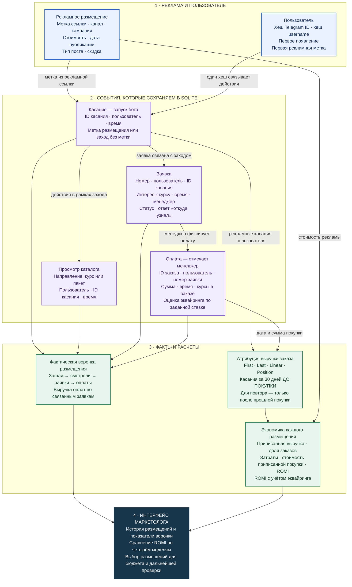
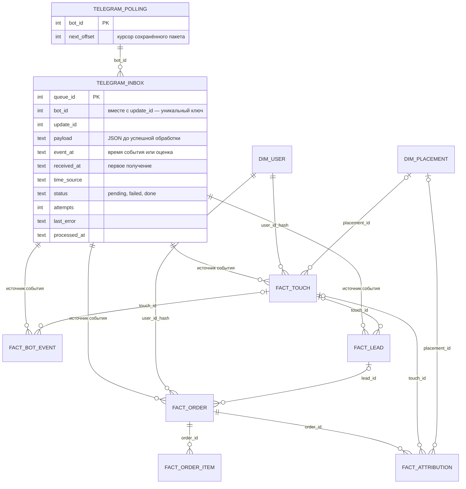
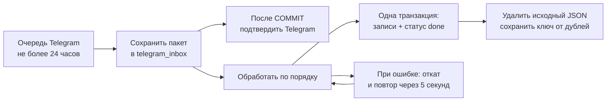

# Поступашки — Marketing Measurement System

Определения показателей, формулы, источники и ограничения: [контракт метрик](metrics.md). Развитие после запуска и дизайн эксперимента: [планы](future_improvements.md).

Цель проекта — сделать воронку продаж видимой и помочь маркетологу оценить эффективность рекламы: какие размещения связаны с покупками, какую выручку им можно приписать и куда стоит направить бюджет.

Система связывает рекламное размещение, касания пользователя, заявку и оплату. Для новых рекламных запусков Telegram-бот собирает путь пользователя до покупки, а интерфейс маркетолога показывает историю размещений и показатели воронки.

## От рекламного касания до решения о бюджете

Схема показывает, что именно сохраняет текущий бот и как эти данные превращаются в показатели. Синие блоки — данные рекламы и пользователя, фиолетовые — события в боте, зелёные — результаты расчёта.



**Что означают цифры в отчёте:**

| Показатель | Как получаем |
|---|---|
| Зашли / смотрели | Число уникальных пользователей с заходом / просмотром по размещению |
| Заявки / оплаты | Число заявок и связанных с ними заказов, а не уникальных людей |
| Выручка по заявкам | Сумма оплат по заявкам, связанным с этим размещением |
| Приписанная выручка | Сумма долей выручки, выделенных размещению выбранной моделью атрибуции |
| Приписанные заказы | Сумма весов заказов; при распределении между касаниями число может быть дробным |
| стоимость приписанной покупки | Затраты на размещение / число приписанных заказов; в текущем коде это стоимость приписанной покупки, не заявки |
| ROMI | (Приписанная выручка − затраты на рекламу) / затраты на рекламу × 100% |
| ROMI с эквайрингом | Та же формула, но из приписанной выручки сначала вычитается соответствующая доля расчётной комиссии |

Воронка связывает заявку с конкретным заходом, а атрибуция рассматривает все подходящие рекламные касания до покупки. Поэтому фактическая выручка по заявкам и приписанная выручка одного размещения могут различаться. При нулевых затратах ROMI не рассчитывается; стоимость приписанной покупки не рассчитывается без приписанных заказов. Эквайринг — оценка по ставке, а не полная себестоимость продукта.

Первый измеримый шаг — запуск бота пользователем. Просмотры рекламы, клики без запуска, переписка менеджера и сама банковская транзакция автоматически не отслеживаются. Оплату вносит менеджер. В аналитических таблицах идентификаторы клиентов хранятся в виде хешей; повторные касания связываются по хешу пользователя. При отсутствии подходящего рекламного касания новая покупка относится к Organic/Direct. Отчёт охватывает всю базу, а 30 дней ограничивают выбор касаний перед каждой покупкой.

Атрибуция помогает распределить наблюдаемую выручку между размещениями; доказательство дополнительного эффекта рекламы требует отдельного эксперимента.

## Схема базы данных и доставки событий

Актуальная схема SQLite — в [data/schema.sql](data/schema.sql); создание таблиц и миграции — в [src/core/db.py](src/core/db.py). Схема ниже показывает связи таблиц. Изображение `outputs/charts/Datadase_SCHEMA.jpg` относится к прежней версии и не содержит очередь доставки.



Связи очереди с бизнес-таблицами логические: по паре `source_bot_id` + `source_update_id`. У старых и синтетических записей эти поля могут быть пустыми. В `fact_touch`, `fact_bot_event`, `fact_lead`, `fact_order` также добавлены `processed_at` и `time_source`. В `dim_placement` добавлен `cost_known`: неизвестные затраты не считаются бесплатным размещением. Для старых внешних размещений с нулём стоимость нужно подтвердить повторным вводом. Изменение схемы применяется автоматически к существующей базе при запуске, без удаления старых данных. Перед обновлением сохраните резервную копию.

| Время | Что означает |
|---|---|
| `timestamp` / `conversation_started_at` | Время исходного сообщения Telegram; для callback-кнопки — время первого получения как оценка |
| `received_at` в очереди | Когда событие впервые надёжно сохранено локально |
| `processed_at` | Когда событие обработано; в бизнес-записи — момент записи внутри обработки |
| `time_source=telegram_message` | Взята дата сообщения Telegram, переведённая в МСК |
| `time_source=received_estimate` | Telegram не передал дату действия; использовано первое получение |
| `time_source=legacy` | Старая или синтетическая запись без новых метаданных доставки |

Для `/paid` время сообщения — время фиксации оплаты менеджером, а не автоматически полученная дата банковской транзакции. У callback-кнопки нельзя использовать дату сообщения с кнопкой: она может быть намного старше самого нажатия.

**Данные очереди:** до успешной обработки `payload` содержит исходное обновление Telegram, включая ID, username и текст сообщения. После успешной обработки JSON удаляется, а идентификатор события и служебные времена сохраняются для защиты от повторов. У ошибочных событий JSON остаётся для повторной обработки. Поэтому резервная копия с незавершённой очередью может содержать персональные данные, а не только хеши.

## Что получает маркетолог

В Telegram-интерфейсе маркетолог создаёт рекламные ссылки, указывает кампанию и стоимость размещения, просматривает историю и сравнивает результаты рекламы:

- сколько пользователей запустили бота, посмотрели курсы, оставили заявку и оплатили;
- какая выручка приписана каждому рекламному размещению;
- как выручка соотносится с затратами на рекламу;
- насколько вывод о распределении бюджета зависит от выбранной модели атрибуции.

Эти данные помогают выбирать размещения для дальнейших вложений и находить рекламу, эффективность которой требует дополнительной проверки. В текущем MVP отчёты рассчитываются по отдельным размещениям; название кампании сохраняется как их характеристика.

Можно расширить отчёт расчётом ROMI по кампании: объединить её размещения, суммировать приписанную выручку и рекламные затраты, затем применить формулу ROMI к этим суммам. Например, так можно оценить результат серии платных публикаций в стороннем Telegram-канале. Покупку одной публикации уже можно оценить как отдельное размещение. Агрегация по кампании пока не реализована; ROMI кампании следует рассчитывать по общим суммам, а не как среднее ROMI её размещений.

## Как считаем вклад рекламы

Пользователь может взаимодействовать с рекламой несколько раз до покупки. Мы сохраняем измеримые касания и распределяем выручку заказа между ними — это атрибуция. Сравниваем четыре модели:

| Модель | Как распределяется выручка |
|---|---|
| First touch | Вся выручка первому рекламному касанию |
| Last touch | Вся выручка последнему рекламному касанию |
| Linear | Поровну между рекламными касаниями |
| Position-based | При трёх и более касаниях: 40% первому, 40% последнему, 20% поровну остальным; при двух — по 50%, при одном — 100% |

По умолчанию учитываем касания за 30 дней до покупки. Для повторной покупки берём только касания после предыдущей. Если подходящих рекламных касаний нет, выручка относится к Organic/Direct; исторические продажи без известного пути пользователя показываются отдельно.

Для каждого рекламного размещения с ненулевой стоимостью рассчитываем возврат маркетинговых инвестиций:

**ROMI = (приписанная выручка − стоимость рекламы) / стоимость рекламы × 100%.**

Например, при затратах 10 000 ₽ и приписанной выручке 15 000 ₽ ROMI составляет 50%. Этот показатель зависит от модели атрибуции и не учитывает все расходы бизнеса. Сравнение четырёх моделей показывает, насколько устойчив вывод об эффективности размещения.

## Как проверяем подход

Сначала изучаем исторические продажи и Telegram-публикации: динамику спроса, суммы заказов, популярные продукты, покупки пакетов и повторные покупки. Это помогает описать наблюдаемое покупательское поведение. Однако в истории нет связки «рекламное касание → пользователь → покупка», поэтому восстановить реальные пути до покупки по этим данным нельзя.

Чтобы проверить модели при нехватке данных о касаниях, используем симуляцию. Она опирается на распределение сумм исторических заказов и динамику спроса в доступном периоде. Пути пользователей, рекламные касания и эффект рекламы задаются в генераторе; моделируются также органические и повторные покупки.

В симуляции сохраняется метка механизма покупки: органическая или рекламная ветка генератора. На первом этапе сравниваем с этими метками распределение выручки четырьмя моделями на одинаковом возрасте размещений. Это диагностическое сравнение, а не измерение причинного прироста. Сценарии «с рекламой / без рекламы» и проверка решений о бюджете — следующий этап.

Атрибуция распределяет уже полученную выручку. Чтобы установить, сколько дополнительных покупок вызвала реклама, нужен эксперимент с контрольной группой.

## Карта проекта

```text
hackaton_project/
├── README.md
├── requirements.txt
├── data/
│   ├── raw/          # исходные продажи и Telegram-посты
│   ├── processed/    # EDA и обработанные данные, post classifier
├── notebooks/        # synthetic data experiment
├── src/
│   ├── bot/          # Telegram-интерфейс
│   └── core/         # БД, attribution, импорт, quality checks
└── outputs/
|   └── charts/       # графики EDA и эксперимента, скрины и схема базы данных наглядная
├── tests/            # тесты
│   ├── conftest.py
│   ├── test_importer.py
│   ├── test_attribution.py
```

### Что где смотреть

В каждой папке лежит свой файл README. Подробная инструкция по запуску и работе с ботом `src/README_bot.md` 

| Раздел | Зачем нужен |
|---|---|
| `data/processed/EDA.ipynb` | EDA продаж и Telegram-постов, классификатор постов |
| `notebooks/` | синтетический эксперимент: баланс выручки, хронология и сравнение D7/D14/D30 |
| `src/bot/main.py` | Telegram-бот и пользовательский / маркетинговый интерфейс |
| `src/core/db.py` | структура SQLite и запись событий |
| `src/core/attribution.py` | first / last / linear / position, attribution и ROMI |
| `src/core/importer.py` | импорт исторических продаж |
| `src/core/quality.py` | проверка полноты данных |
| `outputs/charts/` | готовые графики |

## Запуск Telegram-бота

### 1. Получить токен и ID

1. Откройте **@BotFather** в Telegram, отправьте `/newbot` и следуйте подсказкам. Сохраните выданный токен: это секретный ключ бота. Если токен уже публиковался или отправлялся в переписку, перевыпустите его через @BotFather.
2. Узнайте свой числовой Telegram ID, например через **@userinfobot**. Он нужен для доступа к панели администратора.
3. Попросите каждого менеджера узнать свой ID тем же способом. Запишите ID всех менеджеров и их username без `@`. ID определяет право отмечать оплаты; username используется для перехода к менеджеру из бота.
4. Выберите, куда получать заявки. Для личных уведомлений `MANAGER_CHAT_ID` равен ID получателя. Для общей группы нужен ID самой группы (обычно отрицательное число), а бот должен быть добавлен в неё и иметь право отправлять сообщения. ID группы можно получить из объекта `chat.id` входящего обновления Telegram Bot API. Это отдельное значение, не список ID менеджеров.
5. Для первой проверки используйте себя: свой ID в `ADMIN_IDS`, `MANAGER_IDS` и `MANAGER_CHAT_ID`, свой username в `MANAGER_USERNAME`.

Получателям личных уведомлений нужно открыть созданного бота и нажать **«Старт»**. Список `MANAGER_IDS` даёт права на запись оплат, но не рассылает заявки всем перечисленным: уведомления идут в один `MANAGER_CHAT_ID`.

### 2. Установить зависимости и записать настройки

Команды для Linux/macOS с Bash. Нужен Python 3.10–3.14; рекомендуется 3.12. Из корня репозитория выполните:

```bash
bash scripts/setup.sh
```

Скрипт создаст виртуальное окружение `.venv312`, установит зависимости и последовательно запросит токен, ID администраторов, ID менеджеров, ID чата и username менеджеров. Вводите списки через запятую без пробелов. Токен при вводе не отображается — это нормально. Варианты в квадратных скобках принимаются нажатием Enter.

Настройки сохраняются в **`src/.env`**. Секретная соль `HASH_SALT` создаётся автоматически. При повторной настройке существующая соль сохраняется, чтобы не нарушить связь с пользователями в базе. Остальные существующие значения можно сохранить нажатием Enter. Прерывание через Ctrl+C до завершения ввода не меняет файл.

Чтобы изменить только настройки без установки зависимостей:

```bash
.venv312/bin/python scripts/configure.py
```

Можно заполнить файл вручную вместо интерактивной настройки. Откройте `src/.env` в редакторе и запишите по одной настройке на строку (ниже вымышленные значения, их нужно заменить):

```dotenv
BOT_TOKEN=123456789:replace_with_your_real_token
ADMIN_IDS=111111111
MANAGER_IDS=111111111,222222222
MANAGER_CHAT_ID=111111111
MANAGER_USERNAME=manager_one,manager_two
HASH_SALT=replace_with_random_secret
ACQUIRING_RATE=0
ATTRIBUTION_WINDOW_DAYS=30
DB_PATH=data/bot.db
```

`ACQUIRING_RATE=0.03` означает комиссию 3%; `0` — не учитывать комиссию. Для ручной настройки соль можно получить командой `openssl rand -hex 32`. Не меняйте её после начала сбора данных. Если в существующем файле осталась соль-пример, скрипт попросит заменить её вручную.

Токен, соль, `src/.env`, база и виртуальное окружение не должны попадать в GitHub; соответствующие пути исключены через `.gitignore`.

### 3. Запустить бота

Из корня репозитория:

```bash
bash scripts/start.sh
```

Скрипт использует подготовленное окружение и запускает модуль бота из нужной папки. В этом рабочем каталоге полные команды выглядят так:

```bash
cd /home/valentina/marketing_attribution_system
bash scripts/setup.sh  # первый запуск: установка и настройка
bash scripts/start.sh  # запуск бота после настройки
```

Нужен доступ к Telegram API. После запуска откройте бота, нажмите **«Старт»** и со своего аккаунта администратора отправьте `/menu`. Если панель не появляется, проверьте свой ID в `ADMIN_IDS`. После изменения `.env` перезапустите бота.

SQLite-база создаётся автоматически в `src/data/bot.db` с пустыми рабочими таблицами. Отдельный сервер базы данных не нужен. Данные автоматически не загружаются: новый проект начинает собирать их с первых действий пользователей. Файл базы создаётся ещё до проверки токена, поэтому его наличие не означает, что бот запущен. Успешный запуск сопровождается сообщением `Бот @... запущен`; процесс должен оставаться работающим. Остановка — `Ctrl+C`.

## Как пользоваться ботом

При первом запуске бот работает с пустой базой: в ней нет продаж, размещений, пользователей и касаний. Каталог курсов уже задан в коде. Для новой рекламы начните с чистой базы. Для проверки подключите синтетическую базу; для продолжения работы на другом ПК — полную резервную копию базы с касаниями, заявками и оплатами.

Маркетолог открывает `/menu`. Основной сценарий:

1. `/newlink` — создать рекламное размещение: канал, кампания, стоимость, дата, тип поста.
2. Бот выдаёт отдельную tracking-ссылку для этого размещения.
3. Пользователь переходит по ссылке и запускает бота. Система сохраняет источник и его действия в боте.
4. Если пользователь пришёл без рекламной метки, бот спрашивает, откуда он узнал о продукте.
5. После заявки менеджер проводит продажу и записывает оплату через `/paid`.
6. `/report` — получить воронку, затраты, attributed revenue, стоимость приписанной покупки и ROMI.

### Команды маркетолога

| Команда | Что делает |
|---|---|
| `/menu` | панель управления |
| `/newlink` | создать размещение и tracking-ссылку |
| `/links` | история размещений и ссылок |
| `/report [модель]` | воронка, затраты, стоимость приписанной покупки, attributed revenue и ROMI |
| `/status` | проверить полноту данных |
| `/paid № сумма курсы` | записать оплату по заявке |
| `/export` | скачать согласованную резервную копию базы |

Доступные модели для `/report`: `last`, `first`, `linear`, `position`.

## Что собирает MVP

Система связывает:

**размещение → пользователь → действия в боте → заявка → оплата**

Для каждого размещения маркетолог может увидеть историю кампании, стоимость и дату, измеримые заходы и просмотры, заявки, оплаты и рассчитанный ROMI.

Первый измеримый шаг — **нажатие «Старт» в Telegram**. Сам клик по ссылке без запуска бота Telegram не передаёт.

## Исторические данные и эксперимент

[Анализ исторических данных](data/processed/README_EDA.md) описывает продажи и Telegram-публикации. Доступная история охватывает период 04.08.2026–10.09.2026 и позволяет изучить динамику спроса внутри этого периода.

[Описание симуляции](notebooks/README_experiment.md) объясняет генерацию пользователей, касаний и покупок, а также метрики сравнения четырёх моделей атрибуции. Актуальный эксперимент находится в `notebooks/synthetic_attribution_experiment_updated.ipynb`, вычисления — в `src/experiments/synthetic.py`. Старый Colab-ноутбук оставлен для сравнения.

Mock/synthetic данные не смешиваются с реальными без соответствующей маркировки.

## Окно атрибуции и период отчёта

`ATTRIBUTION_WINDOW_DAYS=30` означает **30 дней назад от даты каждой покупки**, а не от сегодняшнего дня. Например, для покупки 10 сентября подходят касания с 11 августа до момента покупки включительно. Для повторного заказа дополнительно исключаются касания до предыдущей покупки и в момент неё.

Сейчас `/report` использует все данные подключённой базы: фильтра «только последние 30 дней» нет. Окно ограничивает выбор касаний для распределения выручки, а не период продаж или воронки в отчёте. Генерировать ровно 30 дней или переносить данные на текущие даты не нужно.

## Проверка бота на синтетических данных

### Какие данные создаёт генератор

Актуальный [ноутбук этапа 1](notebooks/synthetic_attribution_experiment_updated.ipynb) создаёт 1 000 пользователей, четыре рекламных размещения, рекламные и органические заходы, просмотры и от нуля до двух заказов на пользователя. Для каждой покупки сохраняются связанная заявка и позиция заказа. Неоплаченные заявки пока не моделируются; продукт условный — `synthetic_course`.

История `data/raw/base.csv` задаёт суммы заказов, параметр повторных покупок и сценарий изменения спроса. Этот профиль продаж не считается чистой органикой. Наблюдение продлено до D30 последнего размещения; после окончания истории индекс спроса явно равен среднему уровню 1. Календарная модель естественного спроса — следующий этап.

Для каждого поста эксперимент сравнивает D7/D14/D30, отделяя возраст от окна атрибуции. В самом боте по-прежнему показывается весь период базы. Подробности и ограничения — в [описании эксперимента](notebooks/README_experiment.md).

### Создать базу и подключить её

1. Из корня проекта установите зависимости ноутбука и запустите его в чистом ядре:

```bash
.venv312/bin/python -m pip install -r requirements-notebooks.txt
.venv312/bin/python scripts/run_experiment.py
```

Либо откройте ноутбук с окружением `.venv312` и выполните Restart Kernel → Run All. В Colab нужен актуальный код проекта, включая `src/experiments/synthetic.py`; локальные изменения ещё не появятся в GitHub сами.

2. Последняя ячейка выводит путь к новой папке `outputs/experiments/stage1/seed42_.../`. В ней лежат `synthetic.db`, итоговый рисунок и таблицы результатов. В Colab скачайте `synthetic.db` через панель файлов. Каждый запуск создаёт отдельную папку и не перезаписывает прежнюю базу.
3. Остановите бота через Ctrl+C. Сделайте копию сгенерированного файла для проверки (замените путь на фактический из вывода):

```bash
mkdir -p data/mock
cp -i /полный/путь/к/сгенерированному/synthetic.db data/mock/bot_demo.db
nano src/.env
```

4. Замените `DB_PATH`, сохранив остальные настройки:

```dotenv
DB_PATH=../data/mock/bot_demo.db
ATTRIBUTION_WINDOW_DAYS=30
```

Относительный путь отсчитывается от `src`. Убедитесь, что копия существует: неверный путь создаст пустую базу. Параметр окна должен совпадать с `CONFIG.attribution_days`, если сравниваете расчёты с ноутбуком.

5. Запустите:

```bash
source .venv312/bin/activate
cd src
python -m bot.main
```

6. В Telegram сравните `/report first`, `/report last`, `/report linear`, `/report position`. Там отображаются общая воронка и ROMI по всему периоду. Сравнение постов одинакового возраста и метки механизма генератора остаются в ноутбуке.

### Куда записываются новые действия

**Бот читает и изменяет базу, указанную в `DB_PATH`.** После подключения `bot_demo.db` ваши новые запуски `/start`, просмотры курсов, заявки, размещения и отмеченные оплаты будут записываться в эту копию с текущими датами. Просмотр `/report` также пересчитывает и сохраняет таблицу атрибуции.

Это обычный работающий бот, а не режим просмотра: уведомления менеджерам остаются включёнными. Новые события не получают автоматически признак синтетических (`is_synthetic` по умолчанию равен `0` в таблицах, где он есть). Отчёты сейчас не разделяют данные по этому признаку, поэтому ваши действия изменят демонстрационные показатели. Ваш Telegram-аккаунт будет отдельным пользователем, а не одним из сгенерированных `u00000…`.

Рабочая база `src/data/bot.db` при этом не изменяется. Для возвращения к ней остановите бота, восстановите `DB_PATH=data/bot.db` и запустите снова. Для сброса демонстрации остановите бота и заново скопируйте исходную синтетическую базу в `bot_demo.db`; это заменит данные вашей проверки. Сохранённая отдельно исходная база позволяет повторить демонстрацию без повторной генерации.

## Резервное копирование, восстановление и перенос

У бота одна активная SQLite-база, выбранная через `DB_PATH`. Менеджеры работают через Telegram и не устанавливают программу каждый на свой ПК. Для работы на другом компьютере переносится программа вместе с базой и настройками. Автоматического объединения или синхронизации отдельных баз нет; файлы из чата бот не загружает.

### Сохранить резервную копию

Простой способ — корректно остановить программу через Ctrl+C, дождаться её завершения и скопировать базу и настройки. Пример для стандартного `DB_PATH=data/bot.db`, из корня проекта:

```bash
mkdir -p backups/manual
cp -i src/data/bot.db backups/manual/bot.db
cp -i src/.env backups/manual/.env
chmod 600 backups/manual/.env
```

Если выбран другой `DB_PATH`, копируйте именно этот файл. `cp -i` спрашивает перед заменой существующей копии; для нескольких версий используйте разные папки. Храните дополнительную копию отдельно от компьютера, где работает бот. Папка `backups/` исключена из Git.

Альтернатива без остановки: администратор отправляет `/export` и скачивает согласованный снимок SQLite. Настройки `src/.env` сохраняются отдельно: в выгрузку базы они не входят. Не копируйте обычной файловой командой базу, пока бот пишет в неё.

### Восстановить на этом компьютере

1. Остановите бота и сохраните копию текущей базы, если в ней есть нужные данные.
2. Положите резервную копию в отдельную папку, например `data/restored/bot.db` внутри проекта.
3. В `src/.env` укажите существующий файл:

```dotenv
DB_PATH=/home/valentina/marketing_attribution_system/data/restored/bot.db
```

4. Сохраните ту же `HASH_SALT`, с которой создавалась реальная база. Иначе новые действия прежних пользователей не свяжутся с историей. Проверьте путь командой `ls -lh data/restored/bot.db`: при ошибке в `DB_PATH` программа создаст пустую базу вместо восстановления.
5. Запустите бота и проверьте `/report`:

```bash
source .venv312/bin/activate
cd src
python -m bot.main
```

Бот продолжит дополнять выбранную копию. В копию входят очередь входящих событий и отметки защиты от дублей. Восстановление возвращает состояние на момент резервного копирования: записи, сделанные позже, в этой копии отсутствуют. Это переключение базы, а не объединение с текущими данными.

### Перенести на другой компьютер или сервер

1. Остановите старый экземпляр и сделайте резервную копию по инструкции выше.
2. Перенесите актуальную версию кода проекта на новый компьютер. Локальные изменения не появятся после `git clone`, пока они не отправлены в репозиторий: перенесите их вместе с проектом. Виртуальное окружение `.venv312` переносить не нужно.
3. На новом компьютере с Python 3.12 из корня проекта установите зависимости:

```bash
python3.12 -m venv .venv312
source .venv312/bin/activate
python -m pip install -r requirements.txt
```

4. Восстановите настройки в `src/.env` и базу, например в `data/restored/bot.db`. Сохраните прежние `BOT_TOKEN` и `HASH_SALT`, проверьте ID сотрудников и чата. Исправьте `DB_PATH` на путь нового компьютера. Относительный `DB_PATH=../data/restored/bot.db` также подходит: пути отсчитываются от папки `src`.
5. Запустите `cd src` и `python -m bot.main`. Старый экземпляр с тем же токеном должен оставаться выключенным: один бот обслуживается одним процессом polling.

Для менеджеров перенос прозрачен: они открывают того же Telegram-бота. Для постоянной работы сервер должен оставаться включённым; автозапуск и перезапуск процесса нужно настроить отдельно средствами сервера.

### Синтетика — готовая демонстрационная база

Используйте тот же порядок восстановления, но возьмите файл `synthetic.db` из папки результатов актуального генератора, сделайте копию `data/mock/bot_demo.db` и укажите её в `DB_PATH`. Подробные шаги генерации приведены выше. Сгенерированные пользователи не связаны с реальными Telegram-аккаунтами; свои тестовые действия бот запишет отдельно в демонстрационную копию.

Исторический `base.csv` используется для анализа и калибровки генератора. Он не содержит рекламных касаний и не подходит для проверки полной воронки и атрибуции. Загрузка этой таблицы в интерфейсе бота удалена; библиотечный импортёр остаётся для работы с таблицами и его автоматических тестов. Ручная фиксация менеджером настоящей оплаты через `/paid` остаётся частью рабочего процесса.

## Что происходит, если компьютер спит или бот остановлен

Telegram не изменяет файлы на компьютере. Пока программа выключена или компьютер спит, новых локальных записей нет. Telegram хранит неполученные обновления **не дольше 24 часов**. После небольшого простоя, пока события ещё доступны, программа получает их при восстановлении связи, сохраняет в очередь SQLite и последовательно обрабатывает. При длительном простое события, удалённые Telegram, восстановить из этой очереди нельзя. [Telegram Bot API — Getting updates](https://core.telegram.org/bots/api#getting-updates).



Что гарантирует текущая реализация для поддержанных обработчиков:

- Telegram получает подтверждение только после сохранения пакета на диск. Если сохранение не удалось, пакет не подтверждается.
- Повторная доставка того же `bot_id + update_id` не создаёт новые касания, заявки или оплаты. Записи в бизнес-таблицах и статус `done` фиксируются одной транзакцией; после сбоя незавершённая транзакция откатывается и событие обрабатывается снова.
- События обрабатываются последовательно одним обработчиком, включая действия одного пользователя. Следующее событие не обгоняет предыдущее. При ошибке обработка повторяется через 5 секунд; постоянная ошибка блокирует дальнейшую обработку до устранения причины, а не молча теряет событие. Приём новых событий продолжает сохранять очередь, когда база доступна.
- Даты сообщений после догрузки сохраняются исходными. Точное время клика по inline-кнопке Telegram не передаёт: оно остаётся оценкой по первому получению. Порядок обработки определяется очередью, а не сравнением оценочных дат. Старые callback-ответы «query is too old» и повторное редактирование без изменений не отменяют запись события.
- Повторная фиксация уже оплаченной заявки также отклоняется, даже если менеджер отправил новую команду `/paid`.
- При временной ошибке сети бот повторяет подключение. При переносе базы незавершённая очередь и отметки обработанных событий переносятся вместе с ней. Для второй программы с той же базой предусмотрена блокировка запуска на Linux и macOS.

**Что пока не гарантируется:** сохранение состояний пошаговых диалогов между перезапусками не реализовано. Незавершённое создание размещения и ввод суммы кнопкой нужно начать заново; вместо молчаливого игнорирования бот даёт подсказку. Для оплаты можно использовать самостоятельную команду `/paid номер_заявки сумма`. Короткий сон без завершения процесса сохраняет диалоги в памяти, но перезапуск процесса — нет.

Ответы в Telegram находятся вне транзакции SQLite. При сбое после отправки ответа, но до фиксации базы, повторная обработка может повторить уведомление; отдельной постоянной очереди исходящих сообщений пока нет. Защита от дублей относится к записям базы, а не к гарантии однократной доставки ответов. При постоянной ошибке смотрите журнал процесса: он сообщает ID события и класс ошибки. Не удаляйте очередь, чтобы «разблокировать» бота, без выяснения причины.

Резервная копия содержит состояние на момент её создания. Telegram не пересылает заново уже подтверждённые события, отсутствующие в более старой копии. Для непрерывного сбора данных и своевременного разбора очереди нужен постоянно работающий компьютер или сервер.

## Проверка кода

Из корня репозитория после установки зависимостей:

```bash
.venv312/bin/python -m pytest -q
```

Проверки включают даты после простоя, повторную доставку, откат оплаты при ошибке сети, аварийное завершение процесса, миграцию старой схемы, восстановление копии с очередью, отчёты четырёх моделей, запуск из папки с пробелами и корректную остановку приёмника и обработчика. Telegram в тестах подменяется, реальные сообщения не отправляются.

Для Linux и macOS добавлена [матрица GitHub Actions](.github/workflows/tests.yml) на Python 3.10 и 3.12. Она запустится после публикации изменений в GitHub; наличие workflow не означает, что проверки macOS уже выполнены. Скрипты запуска используют Bash, а блокировка процесса — стандартный для Linux/macOS `flock` из Python `fcntl`.
