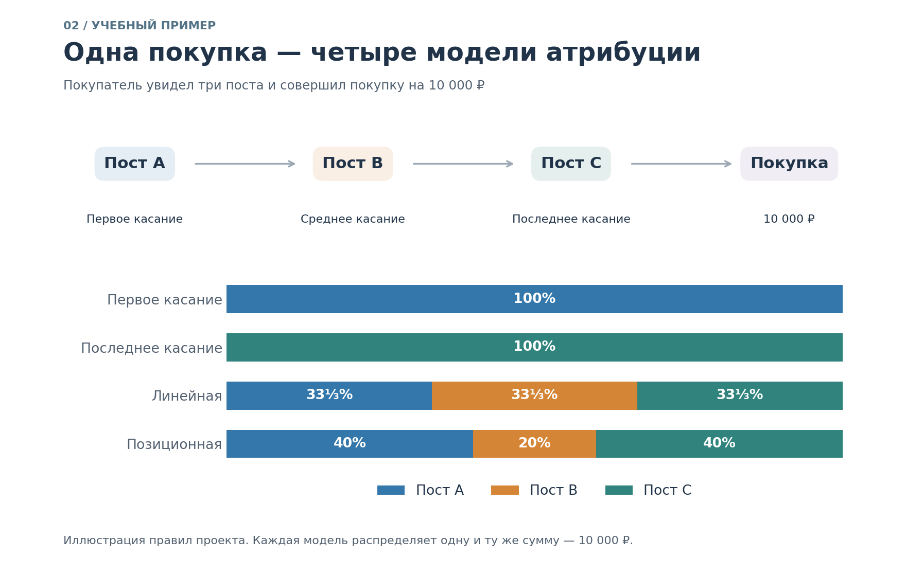

# Какая реклама принесла наибольшую выручку?

Telegram-бот для отслеживания воронки продаж и распределения выручки между рекламными постами.

## 1. Задача

Узнать, по каким рекламным ссылкам люди приходят, какие продукты смотрят и какие покупки совершают. Если перед покупкой было несколько касаний, распределить выручку между постами и сопоставить её с затратами на размещение.

Главная метрика — **приписанная выручка размещения**: часть оплаченных заказов, которую выбранная модель относит к посту. Если известна стоимость размещения, рассчитываем **ROMI = (приписанная выручка − стоимость) / стоимость × 100%**. Отдельно считаем шаги воронки: запуски бота, просмотры, заявки и оплаты.

## 2. Как работает

В боте есть два интерфейса. Пользователь переходит по ссылке из поста, смотрит каталог курсов и цены, выбирает подходящий продукт и оставляет заявку для связи с менеджером. Менеджер вручную отмечает оплату; бот её не принимает.

Маркетолог через своё меню создаёт ссылки для размещений и смотрит статистику: переходы в бот, просмотры, заявки, оплаты и отчёты по выручке. Первый измеримый шаг — запуск бота: просмотр поста и клик без запуска не отслеживаются.

[Работа с ботом](src/operations.md#работа-с-ботом).

## 3. Как запустить

Нужны Python 3.10–3.14 (рекомендуется 3.12) и доступ к Telegram.

1. Создайте бота через [@BotFather](https://t.me/BotFather) и получите токен.
2. Узнайте Telegram ID каждого маркетолога и менеджера: сотрудник может открыть [@userinfobot](https://t.me/userinfobot) и нажать «Старт». Подготовьте также username менеджеров и ID чата, куда будут приходить заявки. Если заявки должны приходить в личные сообщения, используйте ID получателя. Для группы добавьте в неё бота, отправьте команду и найдите `message.chat.id` в ответе [getUpdates](https://core.telegram.org/bots/api#getupdates). Во время этого запроса основной процесс бота должен быть остановлен.
3. Из корня проекта выполните `bash scripts/setup.sh`. Скрипт установит зависимости и последовательно запросит токен, ID маркетологов-администраторов, ID **всех менеджеров**, ID чата для заявок и username менеджеров. Списки вводятся через запятую. Настройки сохраняются в файле `src/.env`.
4. Откройте `src/.env` и проверьте `DB_PATH` — путь к базе SQLite. Стандартное значение `DB_PATH=data/bot.db` указывает на файл **`src/data/bot.db`**, поскольку относительный путь отсчитывается от папки `src`. Если файла ещё нет, бот создаст пустую базу при запуске. Если у вас уже есть база, укажите путь к её файлу.
5. Выполните `bash scripts/start.sh`. Откройте бота и нажмите «Старт». Маркетологу доступна команда `/menu`. Для сбора данных процесс должен оставаться запущенным.

## 4. Данные

Есть **38 дней** истории продаж и публикаций Telegram-канала: 628 заказов, 606 покупателей и 5,9 млн ₽ выручки. В истории нет данных о том, кто пришёл по какому посту. Некоторые всплески продаж совпадают с анонсами, но их причину по этим данным установить нельзя.

Для демонстрации исторические покупки дополнены сгенерированными касаниями, заявками и пользователями без покупок. [Ноутбук EDA](notebooks/00_eda.ipynb).

## 5. Эксперимент

Сравниваем четыре способа распределить выручку покупки между предшествующими касаниями: **First touch, Last touch, Linear и Position-based**. Проверяем расчёты на готовых CSV из [`data/mock/`](data/mock/). [Ноутбук атрибуции](notebooks/02_attribution_demo.ipynb) читает их без повторной генерации; [генератор](notebooks/01_generate_demo.ipynb) нужен только для изменения параметров данных.

Все **64 проверки расчётов** прошли. На демонстрационных данных можно увидеть, какие посты получают больше выручки при каждой модели и насколько вывод зависит от её выбора. Когда начнём собирать реальные данные и затраты, сможем находить потери в воронке и сравнивать размещения по приписанной выручке и ROMI. Эти показатели не отвечают на вопрос, сколько продаж произошло *именно благодаря* рекламе.

## 6. Что дальше

Запустить сбор реальных переходов, просмотров, заявок, оплат и затрат. После накопления данных можно уточнить отчёты и планировать проверку рекламных гипотез.

[Формулы и правила](metrics.md) · [Схема и работа с базой](src/operations.md).
