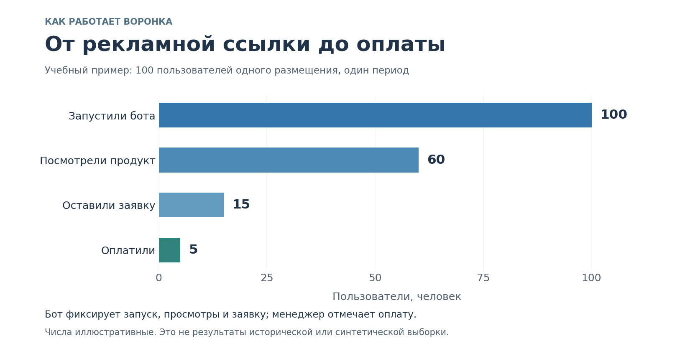
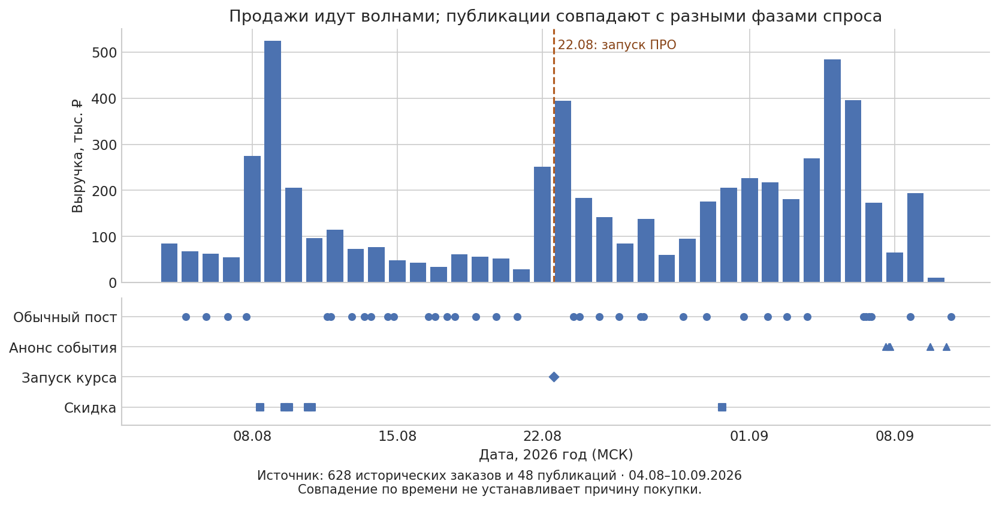

# Какая реклама принесла наибольшую выручку?

MVP для отслеживания воронки и распределения выручки между рекламными постами: Telegram-бот, база данных и четыре модели атрибуции.

## 1. Задача

Сделать путь от рекламы до покупки видимым: сохранять источники переходов, просмотры продуктов, заявки и оплаты. Если покупке предшествовало несколько рекламных касаний, распределить между ними выручку по выбранной модели.

Маркетолог получает отчёт по размещениям: этапы воронки, приписанную выручку и ROMI при известных расходах. Это основа для сравнения рекламы и накопления данных для дальнейших исследований.

## 2. Как работает

Для каждого размещения создаётся отдельная ссылка. Пользователь запускает по ней Telegram-бота, смотрит каталог и оставляет заявку. Бот сохраняет источник и время действий; менеджер общается с клиентом и отмечает оплату. Сам бот оплату не принимает.

Первый измеримый шаг — нажатие **«Старт»**. Просмотр поста и клик без запуска бота не отслеживаются.



Маркетолог создаёт ссылки, указывает характеристики и стоимость размещений, смотрит историю и отчёты. Покупки без отслеженного рекламного пути учитываются отдельно.

[Инструкция по работе с ботом](src/operations.md#работа-с-ботом).

## 3. Данные и EDA

История охватывает **04.08–10.09.2026 — 38 дней**. Есть оплаты курсов и публикации собственного Telegram-канала; реальные касания, заявки и рекламные затраты неизвестны.

| Данные | Объём |
|---|---:|
| Заказы / покупатели | 628 / 606 |
| Позиции заказов / продукты | 795 / 18 |
| Выручка | 5 904 671,67 ₽ |
| Публикации в демонстрационном наборе | 48 |

Несколько курсов одного покупателя с одинаковым временем объединены в один заказ; суммы позиций сохранены.



**Что показал EDA:** спрос неоднороден во времени, в истории есть покупки нескольких курсов и повторные покупки. Один из всплесков совпадает с анонсом линейки ПРО. Без реальных касаний связать рост продаж с конкретным постом нельзя. Категории публикаций размечены по тексту и могут содержать ошибки.

[Ноутбук EDA](notebooks/00_eda.ipynb).

## 4. Демонстрация атрибуции

**Цель — показать работу моделей и проверить расчёты.** Исторические покупки дополнены синтетическими касаниями, заявками и непокупающей аудиторией. Суммы покупок сохранены; их реальный источник остаётся неизвестным.

| Модель | Как распределяет выручку |
|---|---|
| First touch | Первому подходящему касанию |
| Last touch | Последнему подходящему касанию |
| Linear | Поровну между подходящими касаниями |
| Position-based | При трёх и более касаниях: 40% первому, 40% последнему, 20% поровну остальным; при двух — по 50%, при одном — 100% |


Окно атрибуции — **30 дней до покупки**; при повторном заказе учитываются только касания после предыдущей покупки. В генераторе внимание к посту уменьшается вдвое за **7 дней**. Это допущение генерации, а не дополнительный вес в четырёх моделях. Соответствие поста купленному курсу генератор пока не учитывает.

| Ноутбук | Назначение |
|---|---|
| [Обогащение истории](notebooks/01_generate_demo.ipynb) | Создаёт касания и заявки, сохраняет данные и параметры в `data/mock/` |
| [Проверка атрибуции](notebooks/02_attribution_demo.ipynb) | Читает сохранённые данные, сравнивает распределение выручки и проверяет расчёты без повторной генерации |

**Результат проверки:** прошли 64 ручные проверки для четырёх моделей, включая границы окна, повторные покупки и сохранение суммы заказа. На сохранённой выборке также проверены допустимость касаний и баланс выручки. **1,86 млн ₽** остаются без подходящих сгенерированных касаний — это не доказанная органика.

Эта демонстрация не определяет «лучшую» модель реального рекламного влияния. Сравнения D7/D14 — дополнительная диагностика; прежние эксперименты сохранены в `notebooks/archive/`. Выгрузка обогащения не содержит просмотров продуктов: полная воронка выше показана на учебном примере.

## 5. Как запустить

Нужны Python 3.10–3.14 (рекомендуется 3.12) и доступ к Telegram.

1. Создайте бота через [@BotFather](https://t.me/BotFather).
2. Из корня репозитория выполните `bash scripts/setup.sh` и укажите токен, администраторов, менеджеров и чат заявок.
3. Проверьте настройки в `src/.env`. `DB_PATH` задаёт путь к базе; стандартное `data/bot.db` означает `src/data/bot.db`. При отсутствии файла создаётся пустая база.
4. Выполните `bash scripts/start.sh`. Откройте бота и нажмите «Старт»; маркетологу доступна команда `/menu`. Процесс должен оставаться запущенным для сбора данных.

### Анализ на готовых данных

Для анализа Telegram-бот не нужен. Из корня проекта установите зависимости: `pip install -r requirements.txt`.

Готовые демонстрационные CSV сохранены в [`data/mock/`](data/mock/): исторические покупки и публикации дополнены синтетическими касаниями, заявками и непокупающей аудиторией. Запустите [`02_attribution_demo.ipynb`](notebooks/02_attribution_demo.ipynb) — он прочитает эти файлы без повторной генерации. Или загрузите нужную таблицу напрямую:

```python
import pandas as pd
orders = pd.read_csv("data/mock/orders.csv")
touches = pd.read_csv("data/mock/touches.csv")
```

`order_items.csv` содержит позиции заказов, `users.csv` — пользователей, `placements.csv` — посты, `leads.csv` — заявки. Таблицы связаны идентификаторами; параметры и происхождение данных описаны в `manifest.json`, диагностика генерации — в `order_diagnostics.csv`.

Только если нужны другие параметры, выполните [`01_generate_demo.ipynb`](notebooks/01_generate_demo.ipynb) до конца: он обновит CSV в `data/mock/`. Затем повторите анализ. Для запуска ноутбуков используйте `jupyter lab`.

### Структура проекта

| Путь | Содержание |
|---|---|
| `notebooks/00_eda.ipynb` | Анализ исторических продаж и публикаций |
| `notebooks/01_generate_demo.ipynb` | Необязательная генерация демонстрационных данных |
| `notebooks/02_attribution_demo.ipynb` | Атрибуция и проверки на готовых CSV |
| `notebooks/archive/` | Предыдущие эксперименты |
| `data/raw/`, `data/processed/` | Исходная история и подготовленные таблицы |
| `data/mock/` | Готовый демонстрационный набор |
| `outputs/demo/` | Графики и результаты генерации и атрибуции |
| `src/` | Код бота и расчётов |


## 6. Ограничения и следующий шаг

ROMI рассчитывается как `100 × (приписанная выручка − затраты на размещение) / затраты на размещение`. При неизвестных или нулевых затратах он не определён. В демонстрации на исторических покупках расходы неизвестны, поэтому ROMI не рассчитывается.

Атрибуция распределяет выручку по правилам и не доказывает дополнительный эффект рекламы. Проверки расчётов также не подтверждают готовность всей платформы к эксплуатации.

Следующий шаг — запустить сбор реальных касаний, просмотров, заявок, оплат и расходов. После накопления данных можно уточнить правила отчёта и спланировать проверку рекламных гипотез.

[Формулы и правила](metrics.md) · [Схема и работа с базой](src/operations.md).
