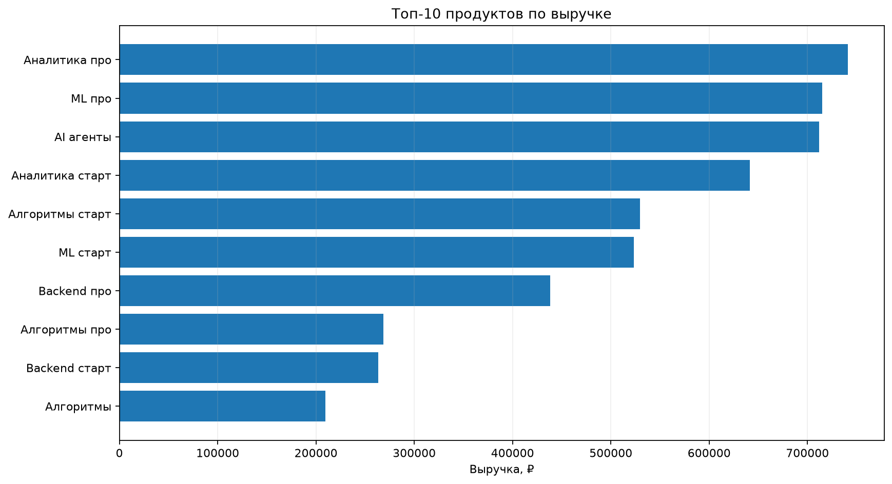
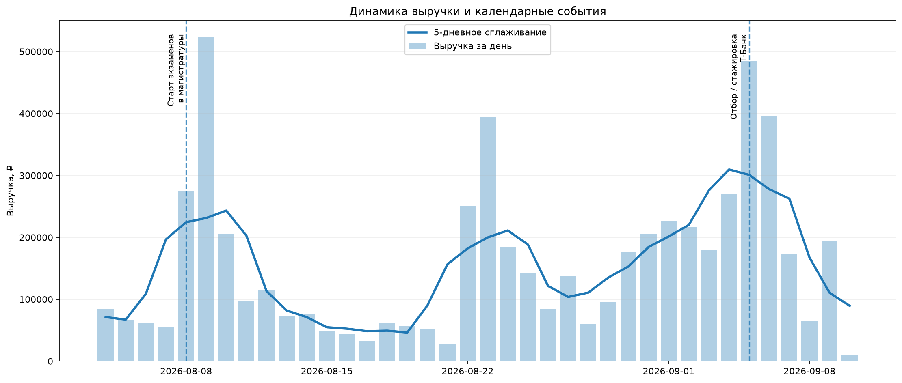
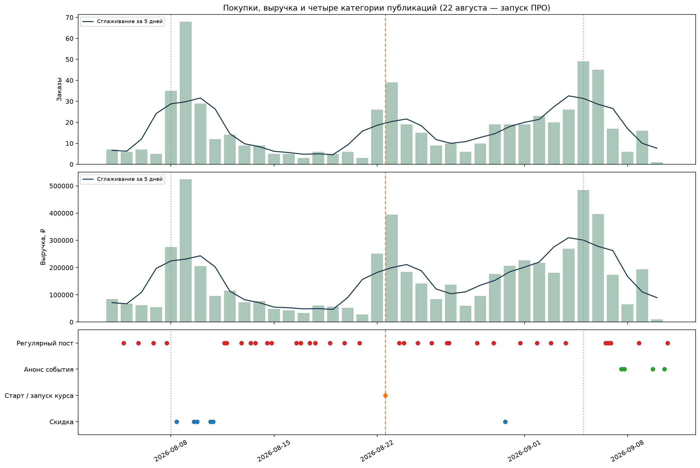
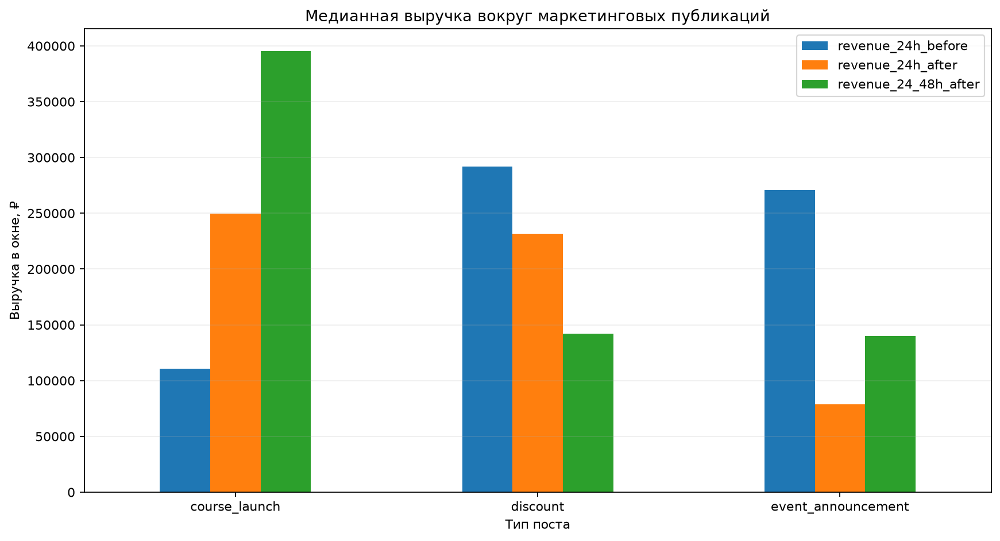
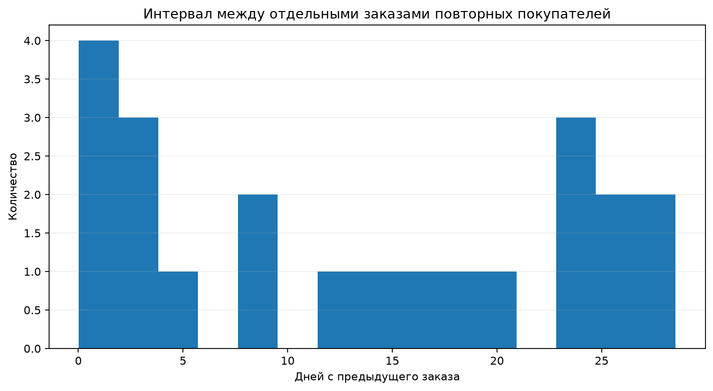
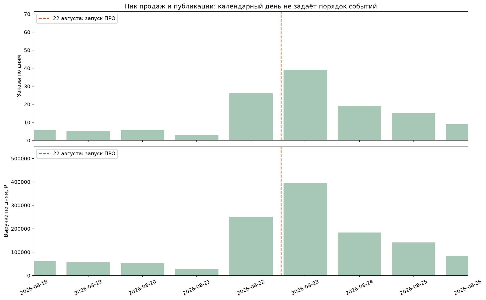

# EDA: продажи и Telegram-публикации

Ноутбук `EDA.ipynb` содержит разведочный анализ исторических данных проекта: продаж и публикаций собственного Telegram-канала.

Цель EDA — понять структуру продаж, исследовать динамику спроса и посмотреть, как покупки располагаются во времени относительно Telegram-публикаций. Исторические данные не содержат связи `пост → пользователь → покупка`, поэтому временные совпадения здесь рассматриваются как **ассоциация, а не причинный эффект**.

## Продажи

Исходная таблица содержит **795 строк продуктов**, но строка не всегда соответствует отдельной покупке. Несколько курсов одного студента с одинаковым timestamp считаются одним bundle-заказом.

После агрегации на уровень заказа:

| Метрика | Значение |
|---|---:|
| Строк продуктов | 795 |
| Заказов | 628 |
| Уникальных покупателей | 606 |
| Продуктов | 18 |
| Выручка | ≈ 5,90 млн ₽ |
| Средний чек заказа | ≈ 9,40 тыс. ₽ |
| Медианный чек заказа | 8,95 тыс. ₽ |
| Bundle-заказов | 153 |
| Повторных покупателей | 20 |
| Доля повторных покупателей | 3,30% |

Такой расчет исправляет ошибку предыдущей версии EDA, где несколько строк внутри одного bundle могли интерпретироваться как повторные покупки.

### Продукты и выручка

Ноутбук отдельно анализирует выручку по продуктам.

## Динамика спроса

Для каждого дня рассчитываются выручка, количество заказов и покупателей. Чтобы лучше видеть общий паттерн спроса, используется 5-дневное сглаживание.

На графике также отмечаются известные календарные события, совпадающие с периодами изменения спроса.

Доступная история продаж охватывает только период **04.08.2026–10.09.2026**, поэтому по ней нельзя надежно оценить годовую сезонность. Здесь корректнее говорить о **календарной динамике спроса внутри доступного периода**.

## Telegram-публикации

Для периода продаж загружаются публикации собственного Telegram-канала и классифицируются rule-based алгоритмом по тексту.

Используются четыре основные категории:

| Категория | Смысл |
|---|---|
| `discount` | скидка, промокод или распродажа |
| `event_announcement` | анонс события, открытой недели, вебинара, занятия |
| `course_launch` | старт/запуск курса, потока или линейки; дата начала занятий может быть неизвестна |
| `regular` | остальные публикации, включая экспертный и продуктовый контент |

При пересечении приоритет — скидка, запуск, анонс, регулярный пост; отдельные флаги сохраняют несколько признаков. Обычный процент в статистике найма скидкой не считается. Упоминание внешней компании не перекрывает тип публикации. `offer_scope` позволяет отличить проверенное внешнее предложение от собственного; неразобранные предложения получают `unclear`.

Разметка — правила и ручная проверка ключевых постов, а не автоматически подтверждённая истина. Причина и метод сохраняются в `analysis_posts_v2.csv`, исходная таблица `analysis_posts.csv` оставлена для сравнения. Правила и проверенные ID — в `src/experiments/posts.py`. Пустые сообщения исключены из текстовой классификации: части альбомов нельзя уверенно считать отдельными публикациями. Источники EDA теперь читаются из локального репозитория, без загрузки другой версии файлов из GitHub.

## Продажи и Telegram-посты

Продажи и публикации совмещаются по времени: на одной шкале показаны дневная выручка, ее сглаженная динамика и timestamps Telegram-постов разных типов.

График помогает увидеть, какие публикации выходили рядом со всплесками продаж. Однако такое совпадение само по себе не доказывает, что публикация вызвала покупку: на спрос одновременно могут влиять внешние события, календарный фактор и другие коммуникации.

## Продажи вокруг маркетинговых публикаций

Дополнительно используется описательный event-study. Для маркетинговых публикаций сравнивается выручка в фиксированных временных окнах:

- 24 часа до публикации;
- 24 часа после публикации;
- 24–48 часов после публикации.

Этот анализ показывает **temporal association**, но не incremental lift. Окна разных публикаций могут пересекаться, а сами публикации могут планироваться на периоды ожидаемого спроса.

## Повторные покупки

Repeat purchase рассчитывается только после перехода на уровень заказа. Несколько курсов, купленных одним студентом одновременно, считаются одним bundle-заказом.

В текущей истории отдельный повторный заказ совершили **20 из 606 покупателей (3,30%)**.

## Вывод

Исторические данные позволяют измерить выручку, заказы, продуктовый микс, bundle-заказы, повторные покупки и временную динамику спроса. Telegram export позволяет восстановить даты и содержание публикаций собственного канала и сопоставить их с продажами по времени.

При этом исторически отсутствует ключевая user-level связь:

`placement → user → touch → lead → order`

Поэтому из EDA нельзя надежно восстановить historical attribution ROMI или incremental effect рекламы. Этот пробел закрывает measurement-flow Telegram-бота: для новых кампаний система начинает собирать источник, placement и пользовательские касания до покупки.

## Пик 22–23 августа: проверка запуска ПРО

В 13:19:48 22 августа опубликован пост №1859: «Для этого мы запускаем ПРО» и «Открываем сразу 5 направлений». Это проверенный запуск линейки; скидка в этом тексте не заявлена. В EDA добавлены отдельный график и точное сравнение заказов до и после публикации, включая одинаковые окна 24 часа.

По локальной истории: 11 заказов на 110 550 ₽ за 24 часа до и 26 заказов на 249 575 ₽ за 24 часа после. Это временная ассоциация: учитывать нужно другие коммуникации, время суток и календарный спрос. Нельзя приписывать посту всю выручку после его выхода или считать весь пик естественным спросом.

Сводный график `posts_sales.png` теперь показывает заказы, выручку и отдельную дорожку четырёх категорий публикаций. В event-study для сводных медиан используются только посты с полностью наблюдаемыми окнами.
