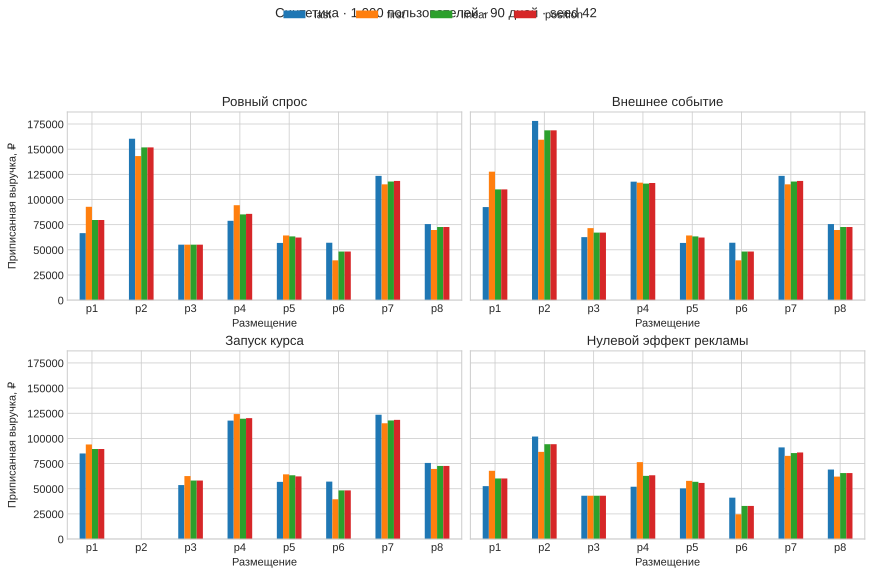
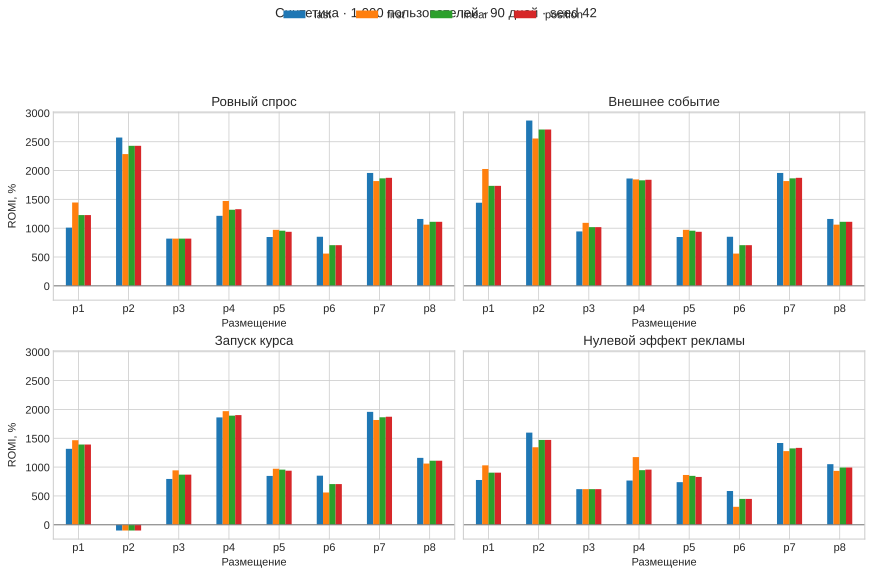

# Проверка маркетинговой атрибуции перед реальным экспериментом

Подготовлены четыре синтетических сценария и выполнены 16 расчётов — по четыре модели на каждый сценарий. Движок сохраняет выручку и соблюдает проверенные временные ограничения. До запуска реального A/B-теста остаются сквозная проверка платформы и настройка назначения групп и сбора исходов.

Расчёты и графики воспроизводятся в [scenario_pilot.ipynb](scenario_pilot.ipynb). Определения и формулы зафиксированы в [metrics.md](../metrics.md).

## Готовность компонентов

| Компонент | Что имеется | Что подтверждено сейчас | Что требуется перед запуском |
|---|---|---|---|
| Сбор данных | Бот регистрирует касания, действия, заявки и оплаты | Реализация и тесты присутствуют в репозитории | Пройти реальный путь пользователя и менеджера через Telegram |
| Хранение | SQLite, связанные таблицы пользователей, размещений, касаний, заявок, заказов, позиций и атрибуции | Схема и код доступны для проверки | Проверить запись, повторную доставку, перезапуск и восстановление на отдельной базе |
| Доступ | Интерфейс маркетолога, настройки менеджеров и пути к базе | Реализованы настройки доступа и отчёты | Проверить доступ разрешённого и постороннего пользователя, выгрузку и резервную копию |
| Атрибуция | First Touch, Last Touch, Linear, Position Based, окно 30 дней | Все четыре модели выполнены на четырёх сценариях | Проверить совпадение результатов ноутбука и отчёта бота |
| ROMI | Распределённая выручка и расходы по размещениям | Рассчитан на заданных синтетических затратах | Подтвердить реальные затраты и полноту данных |
| A/B-тест | Цель и ограничения измерения сформулированы | Проверена часть расчётов, необходимых для подготовки | Определить воздействие, рандомизацию, метрику, срок и размер выборки, сохранять назначение групп и исходы |

**Готовность к запуску реального A/B-теста пока не подтверждена.** Синтетические расчёты выполнены напрямую через движок атрибуции. Текущая выборка ещё не прошла полный путь через Telegram и хранилище.

## Выборка и сценарии

Один прогон с seed 42. В каждом сценарии 1 000 пользователей, 90 дней, два курса и восемь размещений по 6 000 ₽. В генерации есть повторные покупки, несколько курсов в одном заказе, заходы без метки, касания и заявки пользователей без покупок.

| Сценарий | Изменение | Покупатели | Заказы | Заявки пользователей без покупок | Выручка, ₽ |
|---|---|---:|---:|---:|---:|
| Ровный спрос | Постоянный фон и заданная рекламная прибавка | 182 | 185 | 167 | 1 542 859,75 |
| Внешнее событие | Рост фонового спроса на один курс в дни 31–37 | 197 | 202 | 161 | 1 672 171,25 |
| Запуск курса | Второй курс доступен с дня 31, затем временный рост спроса | 162 | 166 | 142 | 1 362 644,75 |
| Нулевой эффект рекламы | Рекламная прибавка и скидки отключены, касания сохраняются | 163 | 166 | 172 | 1 384 796,50 |

Заявки и покупки генерируются отдельно. Число заявок пользователей без покупок нельзя интерпретировать как число неоплаченных заявок всех пользователей — для этого нужна связь конкретной заявки с оплатой.

История задаёт распределение сумм позиций. Частоты касаний, конверсии, затраты и сила всплесков заданы как допущения. Касания размещены в 10:00, покупки в 18:00 условного дня. Такой порядок позволяет проверить покупки после касания в тот же день.

## Выполненные проверки

| Проверка | Результат |
|---|---|
| Исторические строки одного студента с одинаковым точным временем объединяются в заказ | 628 заказов, общая выручка 5 904 671,67 ₽ сохранена |
| Несколько курсов сохраняются отдельными позициями заказа | Суммы синтетических позиций совпали с суммами заказов до копейки |
| Сумма весов каждого заказа равна 1 | Проверка прошла во всех 16 расчётах |
| Распределённая выручка равна исходной | Проверка прошла для каждого заказа |
| Получившие выручку касания находятся в пределах 30 дней до оплаты | Проверка прошла |
| Предыдущие касания не используются после повторной покупки | Проверка прошла, в сценариях есть 3–5 повторных заказов |
| Заказы без подходящих рекламных касаний сохраняются отдельно | Состав этих заказов сверён с отдельным поиском подходящих касаний |
| Все модели используют одинаковые данные и параметры | Проверено в цикле расчёта |

В текущем прогоне проверки не обнаружили нарушений этих условий. Редкие и граничные случаи требуют отдельных примеров — случайная выборка не гарантирует наличие касания ровно на границе окна, повреждённых данных или конфликтующих записей.

## Как модели распределяют выручку

Модели распределяют общую сумму между подходящими касаниями по разным правилам. Для одной выборки сумма выручки, приписанная всем размещениям, совпадает между моделями. Отличаются суммы отдельных размещений и их порядок в рейтинге.

## ROMI по размещениям

ROMI рассчитывается как 100 × (приписанная выручка − затраты) / затраты. Комиссии и остальные расходы бизнеса в этих графиках не учитываются. Положительный ROMI отражает превышение приписанной выручки над указанными затратами.

В сценарии с нулевым эффектом рекламы размещения получили **501 090 ₽**, или **36,2%** всей выручки. У 58 из 166 заказов нашлись подходящие касания. Это показывает, что атрибуция может приписывать рекламе выручку при отключённом дополнительном эффекте. Использовать такой ROMI как оценку причинной окупаемости нельзя.

## Ошибки и ограничения, которые ещё нужно закрыть

- При переносе многокурсового заказа в базу бот делит общую сумму между курсами поровну. Известные исходные суммы позиций нужно сохранять. В историческом ревью найден заказ с неравными суммами курсов.
- Пропуски и нарушенные связи могут теряться при загрузке и объединении таблиц. Нужны счётчики исключений и явное обозначение неполных расчётов.
- Реальные и синтетические данные должны рассчитываться отдельно. Для проверки платформы требуется отдельная база.
- Показатели отчёта включают людей, заявки и заказы. Для конверсий нужно определить общую когорту и срок наблюдения.
- Формулировки отчёта об окупаемости должны учитывать ограничение атрибуционного ROMI.
- Для исторических данных принят ключ заказа «студент + точное время». Разные записи с отдельными идентификаторами заказов в рабочей базе требуют согласованной обработки совпадающего времени.

В репозитории есть автоматические тесты повторной доставки, отката транзакций, восстановления после сбоев, импорта, неизвестных затрат и экспорта базы. В этой проверке полный набор тестов не выполнен — в окружении отсутствует pytest. Их наличие само по себе не подтверждает готовность платформы. Новый сценарный ноутбук выполнен с проверками assert.

## Что позволяет оценить система

- Наблюдаемые касания, заявки, оплаты и повторные покупки при корректной регистрации событий.
- Распределение выручки между размещениями по четырём правилам и чувствительность рейтинга к выбранной модели.
- Соотношение приписанной выручки и известных рекламных затрат.
- Поведение расчётов при росте фонового спроса, запуске курса и нулевой рекламной прибавке.

По текущей синтетике нельзя установить реальные конверсии категорий рекламы, выбрать причинно верную модель или оценить дополнительную выручку бизнеса. Предварительный выбор модели ещё не сделан. Наблюдения получены на одном seed и заданных предположениях.

## Следующий этап

Проверить одну из синтетических выборок через отдельную базу и интерфейс бота. Сопоставить количество событий, заказов, общую выручку и результаты атрибуции с ноутбуком, включая повторную доставку и перезапуск.

После этого подготовить реальный A/B-тест. Зафиксировать воздействие и контроль, единицу рандомизации, основной исход и срок наблюдения. Сохранять назначение группы и результаты всех участников, включая тех, кто не перешёл в бота. Сравнение групп позволит оценить дополнительный эффект выбранного воздействия.
