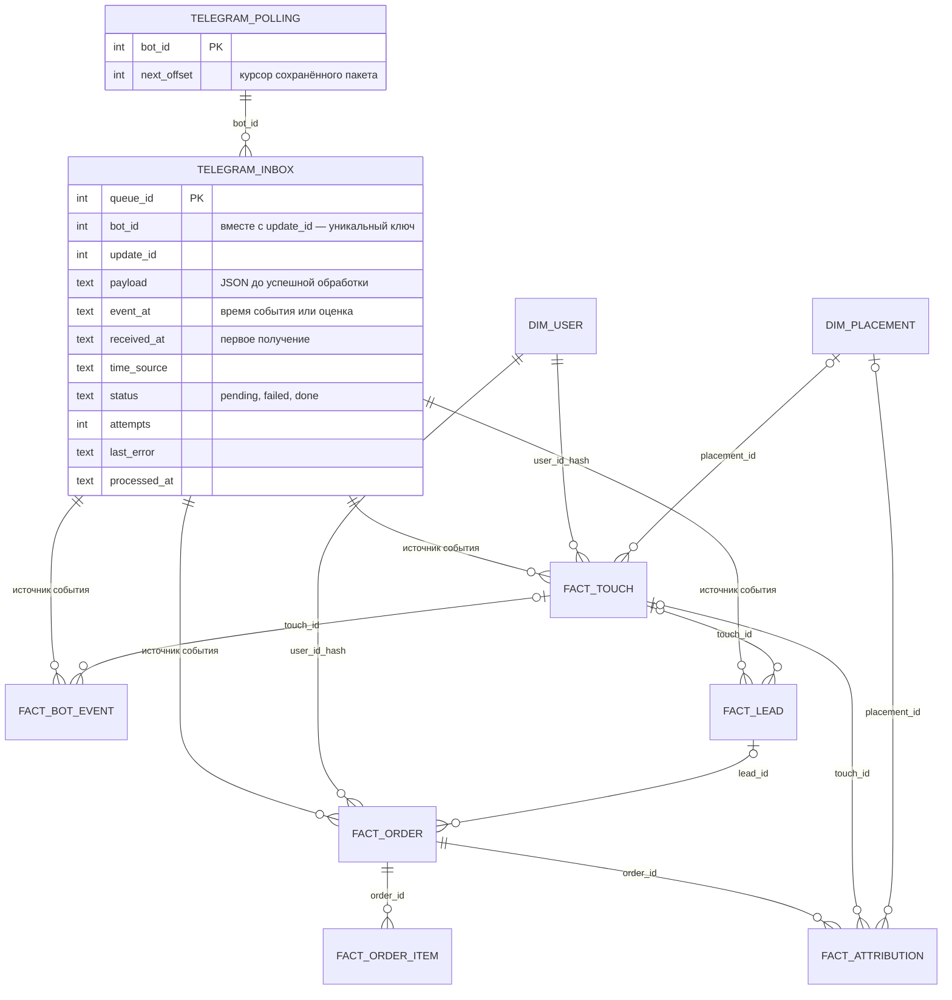
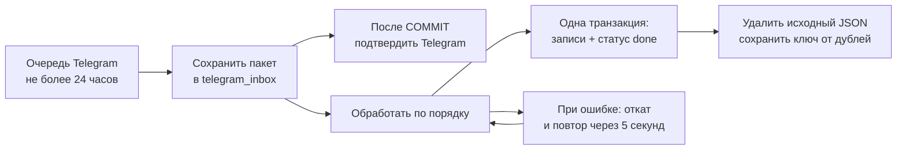

# Технические подробности и работа с базой

[О проекте](../README.md) · [Инструкция по работе с ботом](README_bot.md) · [Формулы и правила расчётов](../metrics.md)

Все команды ниже выполняются из корня репозитория, если не указано иное.

## Схема базы данных и доставки событий

Актуальная схема SQLite — в [data/schema.sql](../data/schema.sql); создание таблиц и миграции — в [src/core/db.py](../src/core/db.py). Схема ниже показывает связи таблиц. Изображение `outputs/charts/Datadase_SCHEMA.jpg` относится к прежней версии и не содержит очередь доставки.



Связи очереди с бизнес-таблицами логические: по паре `source_bot_id` + `source_update_id`. У старых и синтетических записей эти поля могут быть пустыми. В `fact_touch`, `fact_bot_event`, `fact_lead`, `fact_order` также добавлены `processed_at` и `time_source`. В `dim_placement` добавлен `cost_known`: неизвестные затраты не считаются бесплатным размещением. Для старых внешних размещений с нулём стоимость нужно подтвердить повторным вводом. Изменение схемы применяется автоматически к существующей базе при запуске, без удаления старых данных. Перед обновлением сохраните резервную копию.

| Время | Что означает |
|---|---|
| `timestamp` / `conversation_started_at` | Время исходного сообщения Telegram; для callback-кнопки — время первого получения как оценка |
| `received_at` в очереди | Когда событие впервые надёжно сохранено локально |
| `processed_at` | Когда событие обработано; в бизнес-записи — момент записи внутри обработки |
| `time_source=telegram_message` | Взята дата сообщения Telegram, переведённая в МСК |
| `time_source=received_estimate` | Telegram не передал дату действия; использовано первое получение |
| `time_source=legacy` | Старая или синтетическая запись без новых метаданных доставки |

Для `/paid` время сообщения — время фиксации оплаты менеджером, а не автоматически полученная дата банковской транзакции. У callback-кнопки нельзя использовать дату сообщения с кнопкой: она может быть намного старше самого нажатия.

**Данные очереди:** до успешной обработки `payload` содержит исходное обновление Telegram, включая ID, username и текст сообщения. После успешной обработки JSON удаляется, а идентификатор события и служебные времена сохраняются для защиты от повторов. У ошибочных событий JSON остаётся для повторной обработки. Поэтому резервная копия с незавершённой очередью может содержать персональные данные, а не только хеши.

## Проверка бота на синтетических данных

### Какие данные создаёт генератор

Актуальный [ноутбук этапа 1](../notebooks/synthetic_attribution_experiment_updated.ipynb) создаёт 1 000 пользователей, четыре рекламных размещения, рекламные и органические заходы, просмотры и от нуля до двух заказов на пользователя. Для каждой покупки сохраняются связанная заявка и позиция заказа. Неоплаченные заявки пока не моделируются; продукт условный — `synthetic_course`.

История `data/raw/base.csv` задаёт суммы заказов, параметр повторных покупок и сценарий изменения спроса. Этот профиль продаж не считается чистой органикой. Наблюдение продлено до D30 последнего размещения; после окончания истории индекс спроса явно равен среднему уровню 1. Календарная модель естественного спроса — следующий этап.

Для каждого поста эксперимент сравнивает D7/D14/D30, отделяя возраст от окна атрибуции. В самом боте по-прежнему показывается весь период базы. Подробности и ограничения — в [описании эксперимента](../notebooks/README_experiment.md).

### Создать базу и подключить её

1. Из корня проекта установите зависимости ноутбука и запустите его в чистом ядре:

```bash
.venv312/bin/python -m pip install -r requirements-notebooks.txt
.venv312/bin/python scripts/run_experiment.py
```

Либо откройте ноутбук с окружением `.venv312` и выполните Restart Kernel → Run All. В Colab нужен актуальный код проекта, включая `src/experiments/synthetic.py`; локальные изменения ещё не появятся в GitHub сами.

2. Последняя ячейка выводит путь к новой папке `outputs/experiments/stage1/seed42_.../`. В ней лежат `synthetic.db`, итоговый рисунок и таблицы результатов. В Colab скачайте `synthetic.db` через панель файлов. Каждый запуск создаёт отдельную папку и не перезаписывает прежнюю базу.
3. Остановите бота через Ctrl+C. Сделайте копию сгенерированного файла для проверки (замените путь на фактический из вывода):

```bash
mkdir -p data/mock
cp -i /полный/путь/к/сгенерированному/synthetic.db data/mock/bot_demo.db
nano src/.env
```

4. Замените `DB_PATH`, сохранив остальные настройки:

```dotenv
DB_PATH=../data/mock/bot_demo.db
ATTRIBUTION_WINDOW_DAYS=30
```

Относительный путь отсчитывается от `src`. Убедитесь, что копия существует: неверный путь создаст пустую базу. Параметр окна должен совпадать с `CONFIG.attribution_days`, если сравниваете расчёты с ноутбуком.

5. Запустите:

```bash
source .venv312/bin/activate
cd src
python -m bot.main
```

6. В Telegram сравните `/report first`, `/report last`, `/report linear`, `/report position`. Там отображаются общая воронка и ROMI по всему периоду. Сравнение постов одинакового возраста и метки механизма генератора остаются в ноутбуке.

### Куда записываются новые действия

**Бот читает и изменяет базу, указанную в `DB_PATH`.** После подключения `bot_demo.db` ваши новые запуски `/start`, просмотры курсов, заявки, размещения и отмеченные оплаты будут записываться в эту копию с текущими датами. Просмотр `/report` также пересчитывает и сохраняет таблицу атрибуции.

Это обычный работающий бот, а не режим просмотра: уведомления менеджерам остаются включёнными. Новые события не получают автоматически признак синтетических (`is_synthetic` по умолчанию равен `0` в таблицах, где он есть). Отчёты сейчас не разделяют данные по этому признаку, поэтому ваши действия изменят демонстрационные показатели. Ваш Telegram-аккаунт будет отдельным пользователем, а не одним из сгенерированных `u00000…`.

Рабочая база `src/data/bot.db` при этом не изменяется. Для возвращения к ней остановите бота, восстановите `DB_PATH=data/bot.db` и запустите снова. Для сброса демонстрации остановите бота и заново скопируйте исходную синтетическую базу в `bot_demo.db`; это заменит данные вашей проверки. Сохранённая отдельно исходная база позволяет повторить демонстрацию без повторной генерации.

## Резервное копирование, восстановление и перенос

У бота одна активная SQLite-база, выбранная через `DB_PATH`. Менеджеры работают через Telegram и не устанавливают программу каждый на свой ПК. Для работы на другом компьютере переносится программа вместе с базой и настройками. Автоматического объединения или синхронизации отдельных баз нет; файлы из чата бот не загружает.

### Сохранить резервную копию

Простой способ — корректно остановить программу через Ctrl+C, дождаться её завершения и скопировать базу и настройки. Пример для стандартного `DB_PATH=data/bot.db`, из корня проекта:

```bash
mkdir -p backups/manual
cp -i src/data/bot.db backups/manual/bot.db
cp -i src/.env backups/manual/.env
chmod 600 backups/manual/.env
```

Если выбран другой `DB_PATH`, копируйте именно этот файл. `cp -i` спрашивает перед заменой существующей копии; для нескольких версий используйте разные папки. Храните дополнительную копию отдельно от компьютера, где работает бот. Папка `backups/` исключена из Git.

Альтернатива без остановки: администратор отправляет `/export` и скачивает согласованный снимок SQLite. Настройки `src/.env` сохраняются отдельно: в выгрузку базы они не входят. Не копируйте обычной файловой командой базу, пока бот пишет в неё.

### Восстановить на этом компьютере

1. Остановите бота и сохраните копию текущей базы, если в ней есть нужные данные.
2. Положите резервную копию в отдельную папку, например `data/restored/bot.db` внутри проекта.
3. В `src/.env` укажите существующий файл:

```dotenv
DB_PATH=/home/valentina/marketing_attribution_system/data/restored/bot.db
```

4. Сохраните ту же `HASH_SALT`, с которой создавалась реальная база. Иначе новые действия прежних пользователей не свяжутся с историей. Проверьте путь командой `ls -lh data/restored/bot.db`: при ошибке в `DB_PATH` программа создаст пустую базу вместо восстановления.
5. Запустите бота и проверьте `/report`:

```bash
source .venv312/bin/activate
cd src
python -m bot.main
```

Бот продолжит дополнять выбранную копию. В копию входят очередь входящих событий и отметки защиты от дублей. Восстановление возвращает состояние на момент резервного копирования: записи, сделанные позже, в этой копии отсутствуют. Это переключение базы, а не объединение с текущими данными.

### Перенести на другой компьютер или сервер

1. Остановите старый экземпляр и сделайте резервную копию по инструкции выше.
2. Перенесите актуальную версию кода проекта на новый компьютер. Локальные изменения не появятся после `git clone`, пока они не отправлены в репозиторий: перенесите их вместе с проектом. Виртуальное окружение `.venv312` переносить не нужно.
3. На новом компьютере с Python 3.12 из корня проекта установите зависимости:

```bash
python3.12 -m venv .venv312
source .venv312/bin/activate
python -m pip install -r requirements.txt
```

4. Восстановите настройки в `src/.env` и базу, например в `data/restored/bot.db`. Сохраните прежние `BOT_TOKEN` и `HASH_SALT`, проверьте ID сотрудников и чата. Исправьте `DB_PATH` на путь нового компьютера. Относительный `DB_PATH=../data/restored/bot.db` также подходит: пути отсчитываются от папки `src`.
5. Запустите `cd src` и `python -m bot.main`. Старый экземпляр с тем же токеном должен оставаться выключенным: один бот обслуживается одним процессом polling.

Для менеджеров перенос прозрачен: они открывают того же Telegram-бота. Для постоянной работы сервер должен оставаться включённым; автозапуск и перезапуск процесса нужно настроить отдельно средствами сервера.

### Синтетика — готовая демонстрационная база

Используйте тот же порядок восстановления, но возьмите файл `synthetic.db` из папки результатов актуального генератора, сделайте копию `data/mock/bot_demo.db` и укажите её в `DB_PATH`. Подробные шаги генерации приведены выше. Сгенерированные пользователи не связаны с реальными Telegram-аккаунтами; свои тестовые действия бот запишет отдельно в демонстрационную копию.

Исторический `base.csv` используется для анализа и калибровки генератора. Он не содержит рекламных касаний и не подходит для проверки полной воронки и атрибуции. Загрузка этой таблицы в интерфейсе бота удалена; библиотечный импортёр остаётся для работы с таблицами и его автоматических тестов. Ручная фиксация менеджером настоящей оплаты через `/paid` остаётся частью рабочего процесса.

## Что происходит, если компьютер спит или бот остановлен

Telegram не изменяет файлы на компьютере. Пока программа выключена или компьютер спит, новых локальных записей нет. Telegram хранит неполученные обновления **не дольше 24 часов**. После небольшого простоя, пока события ещё доступны, программа получает их при восстановлении связи, сохраняет в очередь SQLite и последовательно обрабатывает. При длительном простое события, удалённые Telegram, восстановить из этой очереди нельзя. [Telegram Bot API — Getting updates](https://core.telegram.org/bots/api#getting-updates).



Что гарантирует текущая реализация для поддержанных обработчиков:

- Telegram получает подтверждение только после сохранения пакета на диск. Если сохранение не удалось, пакет не подтверждается.
- Повторная доставка того же `bot_id + update_id` не создаёт новые касания, заявки или оплаты. Записи в бизнес-таблицах и статус `done` фиксируются одной транзакцией; после сбоя незавершённая транзакция откатывается и событие обрабатывается снова.
- События обрабатываются последовательно одним обработчиком, включая действия одного пользователя. Следующее событие не обгоняет предыдущее. При ошибке обработка повторяется через 5 секунд; постоянная ошибка блокирует дальнейшую обработку до устранения причины, а не молча теряет событие. Приём новых событий продолжает сохранять очередь, когда база доступна.
- Даты сообщений после догрузки сохраняются исходными. Точное время клика по inline-кнопке Telegram не передаёт: оно остаётся оценкой по первому получению. Порядок обработки определяется очередью, а не сравнением оценочных дат. Старые callback-ответы «query is too old» и повторное редактирование без изменений не отменяют запись события.
- Повторная фиксация уже оплаченной заявки также отклоняется, даже если менеджер отправил новую команду `/paid`.
- При временной ошибке сети бот повторяет подключение. При переносе базы незавершённая очередь и отметки обработанных событий переносятся вместе с ней. Для второй программы с той же базой предусмотрена блокировка запуска на Linux и macOS.

**Что пока не гарантируется:** сохранение состояний пошаговых диалогов между перезапусками не реализовано. Незавершённое создание размещения и ввод суммы кнопкой нужно начать заново; вместо молчаливого игнорирования бот даёт подсказку. Для оплаты можно использовать самостоятельную команду `/paid номер_заявки сумма`. Короткий сон без завершения процесса сохраняет диалоги в памяти, но перезапуск процесса — нет.

Ответы в Telegram находятся вне транзакции SQLite. При сбое после отправки ответа, но до фиксации базы, повторная обработка может повторить уведомление; отдельной постоянной очереди исходящих сообщений пока нет. Защита от дублей относится к записям базы, а не к гарантии однократной доставки ответов. При постоянной ошибке смотрите журнал процесса: он сообщает ID события и класс ошибки. Не удаляйте очередь, чтобы «разблокировать» бота, без выяснения причины.

Резервная копия содержит состояние на момент её создания. Telegram не пересылает заново уже подтверждённые события, отсутствующие в более старой копии. Для непрерывного сбора данных и своевременного разбора очереди нужен постоянно работающий компьютер или сервер.

## Проверка кода

Из корня репозитория после установки зависимостей:

```bash
.venv312/bin/python -m pytest -q
```

Проверки включают даты после простоя, повторную доставку, откат оплаты при ошибке сети, аварийное завершение процесса, миграцию старой схемы, восстановление копии с очередью, отчёты четырёх моделей, запуск из папки с пробелами и корректную остановку приёмника и обработчика. Telegram в тестах подменяется, реальные сообщения не отправляются.

Для Linux и macOS добавлена [матрица GitHub Actions](../.github/workflows/tests.yml) на Python 3.10 и 3.12. Она запустится после публикации изменений в GitHub; наличие workflow не означает, что проверки macOS уже выполнены. Скрипты запуска используют Bash, а блокировка процесса — стандартный для Linux/macOS `flock` из Python `fcntl`.
