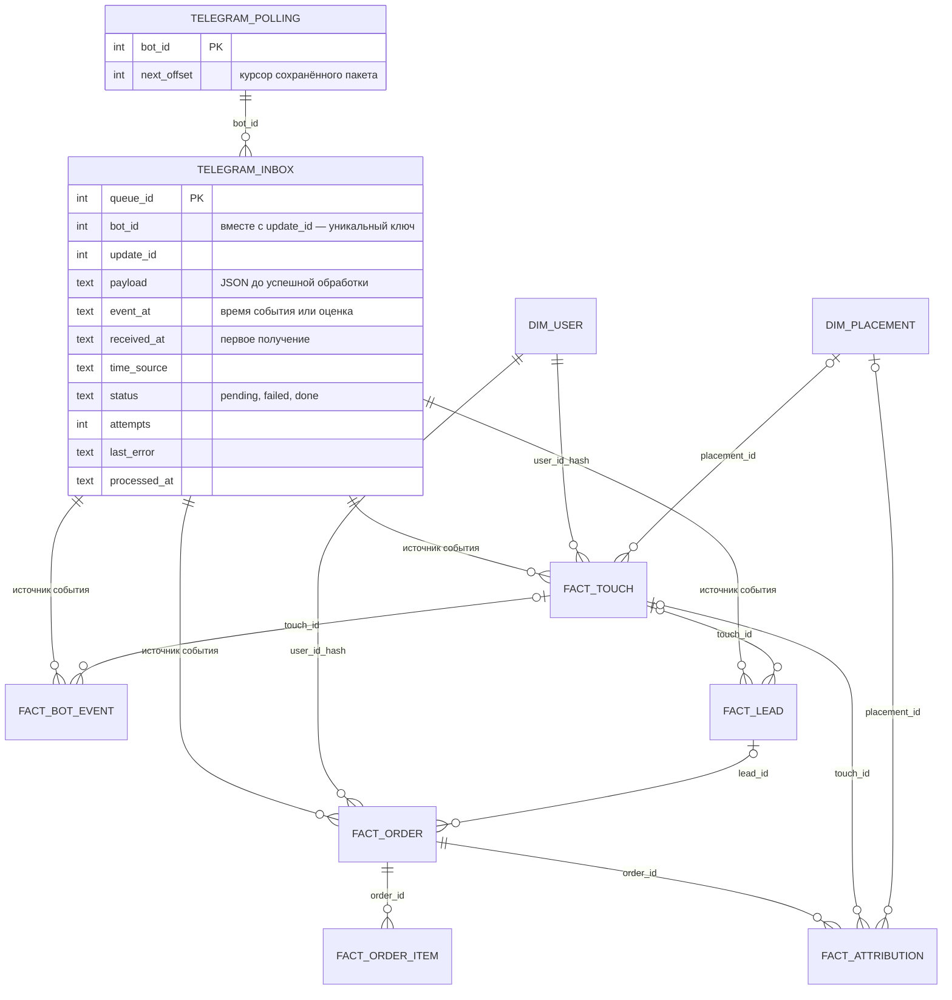
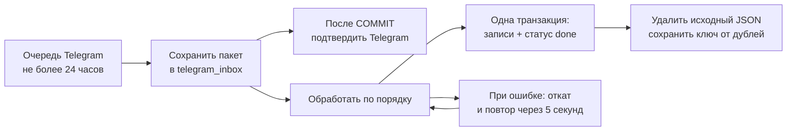

# Технические подробности и работа с базой

[О проекте](../README.md) · [Работа с ботом](#работа-с-ботом) · [Формулы и правила расчётов](../metrics.md)

Все команды ниже выполняются из корня репозитория, если не указано иное.

## Схема базы данных и доставки событий

Актуальная схема SQLite — в [data/schema.sql](../data/schema.sql); создание таблиц и миграции — в [src/core/db.py](../src/core/db.py). Схема ниже показывает связи таблиц. Изображение `outputs/charts/Datadase_SCHEMA.jpg` относится к прежней версии и не содержит очередь доставки.



Связи очереди с бизнес-таблицами логические: по паре `source_bot_id` + `source_update_id`. У старых и синтетических записей эти поля могут быть пустыми. В `fact_touch`, `fact_bot_event`, `fact_lead`, `fact_order` также добавлены `processed_at` и `time_source`. В `dim_placement` добавлен `cost_known`: неизвестные затраты не считаются бесплатным размещением. Для старых внешних размещений с нулём стоимость нужно подтвердить повторным вводом. Изменение схемы применяется автоматически к существующей базе при запуске, без удаления старых данных. Перед обновлением сохраните резервную копию.

| Время | Что означает |
|---|---|
| `timestamp` / `conversation_started_at` | Время исходного сообщения Telegram; для callback-кнопки — время первого получения как оценка |
| `received_at` в очереди | Когда событие впервые надёжно сохранено локально |
| `processed_at` | Когда событие обработано; в бизнес-записи — момент записи внутри обработки |
| `time_source=telegram_message` | Взята дата сообщения Telegram, переведённая в МСК |
| `time_source=received_estimate` | Telegram не передал дату действия; использовано первое получение |
| `time_source=legacy` | Старая или синтетическая запись без новых метаданных доставки |

Для `/paid` время сообщения — время фиксации оплаты менеджером, а не автоматически полученная дата банковской транзакции. У callback-кнопки нельзя использовать дату сообщения с кнопкой: она может быть намного старше самого нажатия.

**Данные очереди:** до успешной обработки `payload` содержит исходное обновление Telegram, включая ID, username и текст сообщения. После успешной обработки JSON удаляется, а идентификатор события и служебные времена сохраняются для защиты от повторов. У ошибочных событий JSON остаётся для повторной обработки. Поэтому резервная копия с незавершённой очередью может содержать персональные данные, а не только хеши.

## Демонстрационные данные

Готовые CSV находятся в `data/mock/`. Ноутбук [демонстрации атрибуции](../notebooks/02_attribution_demo.ipynb) читает их без повторной генерации. Порядок запуска описан в [README](../README.md#анализ-на-готовых-данных).

CSV предназначены для анализа: их нельзя указать в `DB_PATH`, который ожидает SQLite-базу. Для проверки самого бота используйте отдельную тестовую базу. Бот записывает новые действия и пересчитанную атрибуцию в активную базу; уведомления менеджерам остаются включёнными.

## Резервное копирование, восстановление и перенос

У бота одна активная SQLite-база, выбранная через `DB_PATH`. Менеджеры работают через Telegram и не устанавливают программу каждый на свой ПК. Для работы на другом компьютере переносится программа вместе с базой и настройками. Автоматического объединения или синхронизации отдельных баз нет; файлы из чата бот не загружает.

### Сохранить резервную копию

Простой способ — корректно остановить программу через Ctrl+C, дождаться её завершения и скопировать базу и настройки. Пример для стандартного `DB_PATH=data/bot.db`, из корня проекта:

```bash
mkdir -p backups/manual
cp -i src/data/bot.db backups/manual/bot.db
cp -i src/.env backups/manual/.env
chmod 600 backups/manual/.env
```

Если выбран другой `DB_PATH`, копируйте именно этот файл. `cp -i` спрашивает перед заменой существующей копии; для нескольких версий используйте разные папки. Храните дополнительную копию отдельно от компьютера, где работает бот. Папка `backups/` исключена из Git.

Альтернатива без остановки: администратор отправляет `/export` и скачивает согласованный снимок SQLite. Настройки `src/.env` сохраняются отдельно: в выгрузку базы они не входят. Не копируйте обычной файловой командой базу, пока бот пишет в неё.

### Восстановить на этом компьютере

1. Остановите бота и сохраните копию текущей базы, если в ней есть нужные данные.
2. Положите резервную копию в отдельную папку, например `data/restored/bot.db` внутри проекта.
3. В `src/.env` укажите существующий файл:

```dotenv
DB_PATH=/home/valentina/marketing_attribution_system/data/restored/bot.db
```

4. Сохраните ту же `HASH_SALT`, с которой создавалась реальная база. Иначе новые действия прежних пользователей не свяжутся с историей. Проверьте путь командой `ls -lh data/restored/bot.db`: при ошибке в `DB_PATH` программа создаст пустую базу вместо восстановления.
5. Запустите бота и проверьте `/report`:

```bash
source .venv312/bin/activate
cd src
python -m bot.main
```

Бот продолжит дополнять выбранную копию. В копию входят очередь входящих событий и отметки защиты от дублей. Восстановление возвращает состояние на момент резервного копирования: записи, сделанные позже, в этой копии отсутствуют. Это переключение базы, а не объединение с текущими данными.

### Перенести на другой компьютер или сервер

1. Остановите старый экземпляр и сделайте резервную копию по инструкции выше.
2. Перенесите актуальную версию кода проекта на новый компьютер. Локальные изменения не появятся после `git clone`, пока они не отправлены в репозиторий: перенесите их вместе с проектом. Виртуальное окружение `.venv312` переносить не нужно.
3. На новом компьютере с Python 3.12 из корня проекта установите зависимости:

```bash
python3.12 -m venv .venv312
source .venv312/bin/activate
python -m pip install -r requirements.txt
```

4. Восстановите настройки в `src/.env` и базу, например в `data/restored/bot.db`. Сохраните прежние `BOT_TOKEN` и `HASH_SALT`, проверьте ID сотрудников и чата. Исправьте `DB_PATH` на путь нового компьютера. Относительный `DB_PATH=../data/restored/bot.db` также подходит: пути отсчитываются от папки `src`.
5. Запустите `cd src` и `python -m bot.main`. Старый экземпляр с тем же токеном должен оставаться выключенным: один бот обслуживается одним процессом polling.

Для менеджеров перенос прозрачен: они открывают того же Telegram-бота. Для постоянной работы сервер должен оставаться включённым; автозапуск и перезапуск процесса нужно настроить отдельно средствами сервера.

### Демонстрационные CSV и база бота

Текущий генератор сохраняет CSV для анализа, а не `synthetic.db`. Эти таблицы не подключаются через `DB_PATH`. Если у вас уже есть отдельная тестовая SQLite-база совместимой схемы, её можно восстановить по инструкции выше; работайте с копией, поскольку бот будет записывать в неё новые события.

## Что происходит, если компьютер спит или бот остановлен

Telegram не изменяет файлы на компьютере. Пока программа выключена или компьютер спит, новых локальных записей нет. Telegram хранит неполученные обновления **не дольше 24 часов**. После небольшого простоя, пока события ещё доступны, программа получает их при восстановлении связи, сохраняет в очередь SQLite и последовательно обрабатывает. При длительном простое события, удалённые Telegram, восстановить из этой очереди нельзя. [Telegram Bot API — Getting updates](https://core.telegram.org/bots/api#getting-updates).



Что гарантирует текущая реализация для поддержанных обработчиков:

- Telegram получает подтверждение только после сохранения пакета на диск. Если сохранение не удалось, пакет не подтверждается.
- Повторная доставка того же `bot_id + update_id` не создаёт новые касания, заявки или оплаты. Записи в бизнес-таблицах и статус `done` фиксируются одной транзакцией; после сбоя незавершённая транзакция откатывается и событие обрабатывается снова.
- События обрабатываются последовательно одним обработчиком, включая действия одного пользователя. Следующее событие не обгоняет предыдущее. При ошибке обработка повторяется через 5 секунд; постоянная ошибка блокирует дальнейшую обработку до устранения причины, а не молча теряет событие. Приём новых событий продолжает сохранять очередь, когда база доступна.
- Даты сообщений после догрузки сохраняются исходными. Точное время клика по inline-кнопке Telegram не передаёт: оно остаётся оценкой по первому получению. Порядок обработки определяется очередью, а не сравнением оценочных дат. Старые callback-ответы «query is too old» и повторное редактирование без изменений не отменяют запись события.
- Повторная фиксация уже оплаченной заявки также отклоняется, даже если менеджер отправил новую команду `/paid`.
- При временной ошибке сети бот повторяет подключение. При переносе базы незавершённая очередь и отметки обработанных событий переносятся вместе с ней. Для второй программы с той же базой предусмотрена блокировка запуска на Linux и macOS.

**Что пока не гарантируется:** сохранение состояний пошаговых диалогов между перезапусками не реализовано. Незавершённое создание размещения и ввод суммы кнопкой нужно начать заново; вместо молчаливого игнорирования бот даёт подсказку. Для оплаты можно использовать самостоятельную команду `/paid номер_заявки сумма`. Короткий сон без завершения процесса сохраняет диалоги в памяти, но перезапуск процесса — нет.

Ответы в Telegram находятся вне транзакции SQLite. При сбое после отправки ответа, но до фиксации базы, повторная обработка может повторить уведомление; отдельной постоянной очереди исходящих сообщений пока нет. Защита от дублей относится к записям базы, а не к гарантии однократной доставки ответов. При постоянной ошибке смотрите журнал процесса: он сообщает ID события и класс ошибки. Не удаляйте очередь, чтобы «разблокировать» бота, без выяснения причины.

Резервная копия содержит состояние на момент её создания. Telegram не пересылает заново уже подтверждённые события, отсутствующие в более старой копии. Для непрерывного сбора данных и своевременного разбора очереди нужен постоянно работающий компьютер или сервер.

## Проверка кода

Из корня репозитория после установки зависимостей:

```bash
.venv312/bin/python -m pytest -q
```

Проверки включают даты после простоя, повторную доставку, откат оплаты при ошибке сети, аварийное завершение процесса, миграцию старой схемы, восстановление копии с очередью, отчёты четырёх моделей, запуск из папки с пробелами и корректную остановку приёмника и обработчика. Telegram в тестах подменяется, реальные сообщения не отправляются.

Для Linux и macOS добавлена [матрица GitHub Actions](../.github/workflows/tests.yml) на Python 3.10 и 3.12. Она запустится после публикации изменений в GitHub; наличие workflow не означает, что проверки macOS уже выполнены. Скрипты запуска используют Bash, а блокировка процесса — стандартный для Linux/macOS `flock` из Python `fcntl`.


## Работа с ботом

### MVP: трекинг-бот и база измерений

Бот **не** принимает оплату и не выдаёт доступ к курсам: продажа идёт через менеджера, как сейчас.
Его задача - собирать данные, которых раньше не было.

### Роли

| Кто | Что делает | Что попадает в базу |
|---|---|---|
| Клиент | переходит по ссылке из рекламы, смотрит курсы, оставляет заявку | заход с меткой, просмотры, заявка |
| Менеджер | получает уведомление о заявке, продаёт, отмечает оплату кнопкой | заказ и курсы в нём |
| Админ | заводит размещения через `/newlink`, смотрит отчёты | канал, стоимость, дата, тип поста |

### Структура кода

```
bot/main.py            обработчики Telegram: меню курсов, заявки, оплаты, панель админа
core/db.py             схема SQLite, миграции и запись бизнес-событий
core/delivery.py       сохранение очереди входящих обновлений
bot/reliable.py        подтверждение, последовательная обработка и повторы
core/attribution.py    правила атрибуции, воронка, ROMI
core/catalog.py        курсы, направления, пакеты
core/importer.py       импорт base.xlsx в fact_order
core/quality.py        проверка полноты данных для /status
core/config.py         настройки из .env
data/schema.sql        структура таблиц (сама база создаётся при первом запуске и в репозиторий не созпаняется)
```

### База данных

Всё хранится в `data/bot.db` (SQLite), файл создаётся автоматически при первом запуске.
Справочники с префиксом `dim_`, факты — с `fact_`.

| Таблица | Что хранит | Кто заполняет |
|---|---|---|
| `dim_placement` | размещение: метка, канал, кампания, тип поста, скидка, стоимость, время публикации | админ, `/newlink` |
| `dim_user` | пользователь: хеш Telegram ID, хеш username, когда и по какой метке пришёл | бот |
| `fact_touch` | заход в бота: кто, по какой метке, когда | бот |
| `fact_bot_event` | что смотрел: направление, курс, пакет | бот |
| `fact_lead` | заявка: интерес, ответ «откуда узнал», время, менеджер, статус | бот и менеджер |
| `fact_order` | оплата: сумма, эквайринг, время, связь с заявкой | менеджер или импорт base.xlsx |
| `fact_order_item` | курсы внутри заказа, чтобы не терялись пакеты | вместе с заказом |
| `fact_attribution` | кому приписана выручка: модель, доля, сумма | пересчитывается при `/report` |
| `telegram_inbox` | входящие события, даты, статусы и ключи защиты от дублей | приёмник и обработчик |
| `telegram_polling` | курсор последнего сохранённого пакета для бота | приёмник |

Вся система держится на двух связях:

- `fact_touch.placement_id -> dim_placement` — из какой рекламы пришёл человек;
- `fact_order.lead_id -> fact_lead -> fact_touch` — какая реклама закончилась деньгами.

Пустое значение тоже несёт смысл: пустой `placement_id` означает «пришёл сам», пустой `lead_id` -
«старая продажа из base.xlsx, источник неизвестен». В отчёте это отдельные строки, а не общая куча.

Бот записывает данные не напрямую: обработчики вызывают функции из `core/db.py`
(`add_touch`, `create_lead`, `add_order` и другие), которые выполняют `INSERT` с подстановкой
значений через `?`. При обработке входящего обновления все изменения и отметка завершения фиксируются одной транзакцией; промежуточные `commit()` откладываются до её окончания.

**Приватность.** В аналитических таблицах идентификаторы клиентов хранятся в виде хешей с солью из `.env`. Очередь `telegram_inbox` временно содержит исходные ID, username и текст для восстановления после сбоя. После успешной обработки JSON очищается; при ошибке сохраняется для повторной попытки. Сохраняйте резервные копии с учётом этого.

Обновлённая схема, времена события и обработки, порядок восстановления и ограничения приведены в [технической инструкции](operations.md#схема-базы-данных-и-доставки-событий). SQL-схема: [data/schema.sql](../data/schema.sql).

### Атрибуция и ROMI

Три правила движка:

1. **Окно 30 дней** (`ATTRIBUTION_WINDOW_DAYS`). Если человек зашёл по рекламе, а купил позже,
   касание «протухло» и выручку не получает.
2. **Повторные покупки.** Для каждого заказа берутся только касания после предыдущей покупки
   этого клиента: реклама, уже приведшая к первой покупке, за вторую заслуг не получает.
3. **Органика.** Если рекламных касаний в окне нет, выручка не пропадает, а уходит в Organic/Direct.

Модели на примере: реклама в канале A -> через неделю пост в B -> промокод в C -> покупка 10 000 руб.

| Модель | Логика | A | B | C |
|---|---|---|---|---|
| `last` (по умолчанию) | всё последнему касанию | - | - | 10 000 |
| `first` | всё первому | 10 000 | - | - |
| `linear` | поровну | 3 333 | 3 333 | 3 333 |
| `position` | 40% первому, 40% последнему, 20% средним | 4 000 | 2 000 | 4 000 |

ROMI = (приписанная выручка − стоимость) / стоимость. Если задан `ACQUIRING_RATE`, считается ещё
и ROMI с учётом комиссии. Для своего канала (стоимость 0) ROMI не считается, показывается только воронка.

**Атрибуция не равна инкрементальности.** ROMI показывает, кому приписана уже случившаяся покупка,
а не то, случилась бы она без рекламы. Для настоящего эффекта нужен holdout-эксперимент.

### Запуск

Установка, настройка и запуск из корня репозитория описаны в [основном README](../README.md#5-как-запустить). Настройки хранятся в `src/.env`; относительный `DB_PATH` отсчитывается от `src`.

---|---|
| `BOT_TOKEN` | токен Telegram-бота |
| `ADMIN_IDS` | Telegram ID пользователей с доступом к админ-панели |
| `MANAGER_CHAT_ID` | чат, куда бот отправляет заявки |
| `MANAGER_IDS` | пользователи, которым разрешено фиксировать оплаты |
| `MANAGER_USERNAME` | username менеджера/менеджеров |
| `HASH_SALT` | секретная соль для хеширования идентификаторов |
| `ACQUIRING_RATE` | комиссия эквайринга, например `0.03` |
| `ATTRIBUTION_WINDOW_DAYS` | окно атрибуции; по умолчанию 30 дней |

Запустите:

```bash
cd src
python -m bot.main
```

SQLite-база создаётся автоматически при первом запуске. `.env` и рабочую базу с пользовательскими данными не нужно коммитить в GitHub.

---


После запуска начинайте собирать новые касания и оплаты в чистой базе. Для демонстрации подключите синтетическую базу, а для переноса на другой ПК — полную резервную копию `.db`. Пошаговые инструкции находятся в [технической инструкции](operations.md#резервное-копирование-восстановление-и-перенос).

### Команды

Команда `/menu` открывает панель с кнопками, помнить команды не обязательно (они доступны только админу)

| Команда | Что делает |
|---|---|
| `/menu` | панель: размещения, отчёты, ROMI, полнота данных |
| `/newlink` | создать размещение — бот спросит метку, канал, стоимость, дату, кампанию, тип поста |
| `/links` | все размещения и ссылки для постов |
| `/report [модель]` | воронка, затраты, приписанная выручка, стоимость приписанной покупки и ROMI по каждому размещению |
| `/status` | какие поля не заполнены и что не видно даже с ботом |
| `/paid № сумма курсы` | ручная запись оплаты по номеру заявки |
| `/export` | скачать согласованную резервную копию базы |

### Что знаем, что оцениваем, чего не видим

| Уровень | Что относится |
|---|---|
| **Знаем** (факты) | оплаты из base.xlsx; заходы по меткам, просмотры и заявки из бота; стоимость и дата размещения из `/newlink` |
| **Оцениваем** (модель) | приписанная выручка, ROMI, стоимость приписанной покупки; эквайринг по ставке из `.env` - в базе помечен как `rate_estimate` |
| **Не видим** | клики по ссылке без нажатия «Старт» (Telegram их не передаёт); переписку менеджера; клиентов, написавших менеджеру напрямую; источник покупок из base.xlsx; купил бы клиент без рекламы |

### Ограничения
- Первый измеримый шаг - нажатие «Старт», поэтому воронка начинается с заходов, а не с кликов.
- Если клиент написал менеджеру напрямую, источник теряется. Нужна причина заходить через бота
  (каталог, пакеты, промокоды), а менеджер спрашивает номер заявки или «откуда узнали».
- Покупатели из base.xlsx и пользователи бота пока не склеиваются: в выгрузке только обезличенный
  `student_id`. Для склейки бизнесу нужно хешировать username тем же способом, что и бот.
- `.env` и `data/bot.db` в репозиторий не попадают: там токен и данные пользователей.

## Типовой сценарий работы маркетолога

### Шаг 1. Создать рекламное размещение

Откройте:

`/menu` → **Создать размещение**

или используйте:

`/newlink`

Бот последовательно запросит параметры размещения: метку, канал, кампанию, стоимость, дату публикации и характеристики поста.

После создания бот выдаёт уникальную ссылку.

**Важно:** для каждого отдельного размещения нужно создавать отдельную ссылку. Именно по ней система понимает, откуда пришёл пользователь.

Пример бизнес-логики:

```text
Telegram-канал A
        ↓
placement A
        ↓
уникальная ссылка
        ↓
пользователь запускает бота
        ↓
touch A
```

### Шаг 2. Использовать ссылку в рекламном посте

Разместите полученную ссылку в соответствующем рекламном посте.

Первый измеримый шаг системы — запуск бота пользователем по этой ссылке. Сам клик, после которого пользователь не нажал Start, Telegram-бот не видит.

### Шаг 3. Получить заявку

После входа пользователь может смотреть продукты и оставить заявку.

В системе появляются события воронки:

**зашёл → смотрел → оставил заявку**

Менеджер получает уведомление о заявке.

### Шаг 4. Зафиксировать оплату

После реальной продажи менеджер отмечает оплату в боте.

Для ручной записи доступна команда:

```text
/paid №_заявки сумма курсы
```

После этого появляется заказ, связанный с заявкой и, если источник известен, с рекламным касанием.

### Шаг 5. Посмотреть результат рекламы

Используйте:

`/report`

В отчёте по каждому размещению показываются:

- сколько пользователей зашло;
- сколько посмотрело продукт;
- сколько оставило заявку;
- сколько оплатило;
- затраты на размещение;
- приписанная выручка;
- стоимость приписанной покупки;
- ROMI.

Пример логики отчёта:

```text
зашли  →  смотрели  →  заявки  →  оплаты
  100          60          15          5

cost: 30 000 ₽
attributed revenue: 50 000 ₽
ROMI: +66,7%
```

Числа выше — только пример, не фактический результат проекта.

---


### Резервные копии и демонстрационная база

Загрузка файлов через Telegram удалена. Для чистого запуска бот создаёт новую базу; для восстановления или проверки синтетики укажите существующий файл `.db` в `DB_PATH` и перезапустите программу. `/export` позволяет скачать согласованный снимок базы; настройки `src/.env` сохраняются отдельно. Подробности переноса, сохранения `HASH_SALT` и поведения при простое описаны в [технической инструкции](operations.md#резервное-копирование-восстановление-и-перенос).
